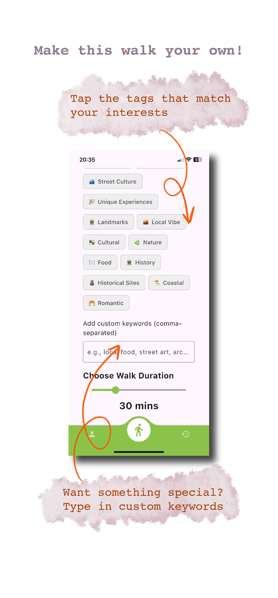
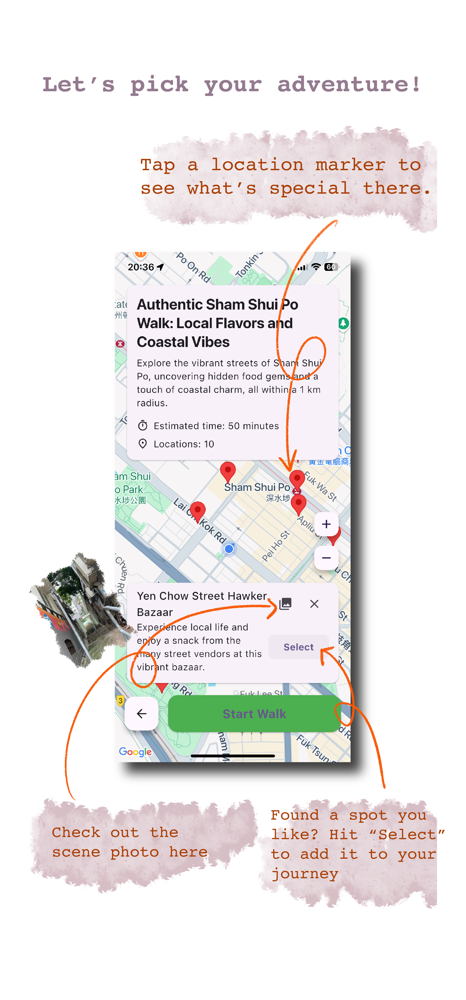
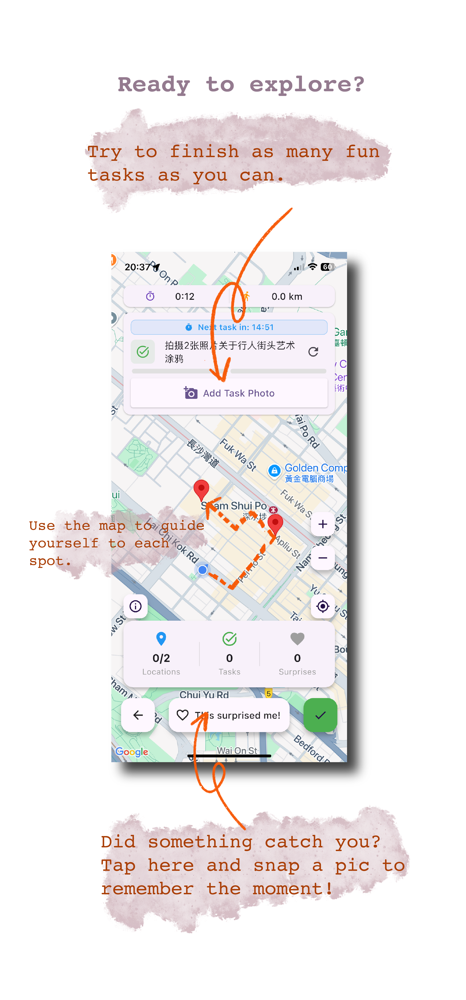

# City Walk

**English** · Flutter package name: `mambo`

A walking app, not a map with pins. Pick a few keywords and how long you have; City Walk generates a route you actually walk — GPS on Google Maps, tasks at each stop, photo logs, and a scrapbook when you get home.

The UI is Chinese-first (`zh_CN`). Keywords are written for a Hong Kong walk.

<p align="center">
  
  
  
</p>

<p align="center">
  <em>In-app tutorial (English slides). The rest of the app is Chinese-first.</em>
</p>

## How a walk works

1. **Setup** — choose keywords (street culture, food, landmarks, nature, …) and a duration, then tap **生成路线**. Custom keywords can be separated with commas or 、.
2. **Preview** — the generated walk lands on Google Maps with every stop selected. Drop the ones that are wrong for *this* afternoon before you commit. Distances are straight-line (Haversine) estimates at walking speed.
3. **Walk** — live location, photo tasks checked by GPT, stops collected when you get within 20 m, and a button to mark anything that surprised you.
4. **Summary** — the numbers, the path you walked, an AI-written story (generated once, then kept on the device) and your photos. History lives on the same account.

Leaving a walk pauses it. Closing the app mid-walk does not lose it either: Home shows an in-progress card to resume or give up.

Bottom nav: **profile** · **walk** · **history**.

There is also a lighter flow without a generated route: start recording from the setup page, add photos as you go, review the day afterwards and generate a scrapbook cover. Those records appear under History → 记录.

## Screenshots

| Tutorial 1 | Tutorial 2 | Tutorial 3 |
| --- | --- | --- |
|  |  |  |

The marker used for surprise spots on the map:

<p align="center">
  
</p>

## Prerequisites

- [Flutter](https://docs.flutter.dev/get-started/install) **3.47.6** (Dart 3.13). CI pins this version.
- Xcode (iOS 15+) or Android Studio / an Android device-emulator
- A **Google Maps** API key with Maps SDK for Android / iOS enabled
- A **Supabase** project (auth)
- A **GraphQL** API that implements the walk/log operations the app calls
- **Cloudinary** (image upload, unsigned preset)

## Setup

```bash
git clone https://github.com/lvyin1122/city_walk.git
cd city_walk
flutter pub get
```

### 1. Build-time configuration

```bash
cp .env.example .env
```

Fill in `.env`:

```env
SUPABASE_URL=
SUPABASE_ANON_KEY=
GRAPHQL_ENDPOINT=
CLOUDINARY_CLOUD_NAME=
CLOUDINARY_UPLOAD_PRESET=
```

`.env` is git-ignored. Its values are passed to the build with `--dart-define-from-file` and compiled into the app, so anyone who has the app can read them. Put only values that are safe to publish there, never a service-role key or a third-party API secret.

### 2. Google Maps keys

The keys live in two git-ignored files. Copy the examples and fill them in:

| Platform | Copy | To |
| --- | --- | --- |
| Android | `android/secrets.properties.example` | `android/secrets.properties` |
| iOS | `ios/Flutter/Secrets.example.xcconfig` | `ios/Flutter/Secrets.xcconfig` |

Restrict each key to this app's package name / bundle identifier in the Google Cloud console. Without a key the app still builds and runs; the map stays blank.

### 3. Run

```bash
flutter run --dart-define-from-file=.env
```

Without the `--dart-define-from-file` argument the app starts on a screen listing the missing configuration.

First launch: sign up or sign in (Supabase). Signed-in users land on the walk setup page; the three tutorial slides are shown once.

On iOS, run `pod install` in `ios/` after cloning or after changing dependencies. `ios/Podfile.lock` is currently not in the repository: generate it on macOS and commit it.

```bash
flutter analyze   # no issues expected
flutter test
```

## Permissions the app asks for

Needed for the walk loop, not optional chrome:

- **Location** (when in use + background) — track the route
- **Camera** — task evidence during a walk
- **Photo library** — save summaries and pick images

On iOS these are declared in `ios/Runner/Info.plist`. On Android they are in `AndroidManifest.xml`.

## Project layout

```
lib/
  main.dart                 start-up checks → auth wrapper → home
  app/env.dart              build-time configuration
  core/api/                 ApiClient (token, timeout, errors), GraphQL string escaping
  core/geo/                 GeoPoint, distance, bearing, walking time
  core/map/ media/ format/  map helpers, photo picking and compression, formatters
  features/auth/            sign in / sign up
  features/home/            home, setup form, history tab, profile, tutorial, records
  features/walk/            domain models, repository, preview, live map, summary
  services/                 GraphQL operations, records, auth, Cloudinary
  theme/                    colours and type
test/                       unit and widget tests, mirroring lib/
docs/                       product/UX/marketing analysis and technical review
```

See `CLAUDE.md` for the conventions the code follows.

## Stack

Flutter · Dart · Google Maps · Supabase Auth · GraphQL · Cloudinary · shared_preferences · audioplayers

## Backend contract (short)

The client does not embed walk-generation logic. It calls GraphQL, including:

- `generateWalk` / `generateWalkWithGpt` — keywords + duration → walk + locations
- `getLatestInProgressWalk` — resume card on home
- `addWalkCoordinate` / `updateWalkStats` — live tracking
- `verifyTaskWithGpt` — photo/task check
- `addLogEntry`, scrapbook and reflection mutations

Point `GRAPHQL_ENDPOINT` at an API that implements those operations or the generate button will fail.

Every request carries the signed-in user's Supabase access token as `Authorization: Bearer …`. The backend should verify it and take the user from the token; the `userId` arguments are still sent for compatibility. If a backend rejects the header, build with `--dart-define=API_SEND_AUTH_HEADER=false`.

Use an `https` endpoint. Android and iOS block plain `http` connections by default.

## Notes

- The app is called **Mambo** (漫步) on both platforms. The bundle identifier `com.example.mambo` is a placeholder: choose the real one before the first store submission.
- The UI is Simplified Chinese (`zh_CN`), hard-coded; localisation is not set up yet. Tutorial screenshots above are the English asset set.
- `.github/workflows/ci.yml` runs analyze, tests and an Android debug build on every push and pull request. An unsigned iOS IPA can be built from `.github/workflows/dart.yml` (`workflow_dispatch`); it needs the `APP_ENV` and `MAPS_API_KEY_IOS` repository secrets.
- Only iOS and Android are supported; the web and desktop folders were removed.
