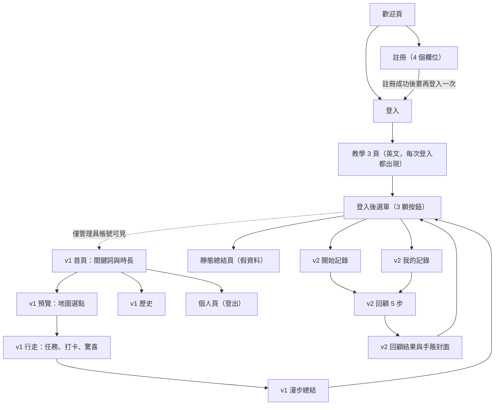
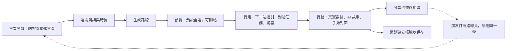

# Mambo 漫步（City Walk）— Product・UX・Marketing 分析

> 分析基準：commit `bbf67d9`（2026-09-11）　｜　撰寫日期：2026-10-08
>
> 分析前提（已與產品負責人確認）：
> - **目標市場**：海外華人與國際旅客，中英雙語，旅行場景
> - **產品主線**：v1「AI 生成路線 + 任務打卡」；v2 的自由記錄、AI 回顧、手賬封面視為附加能力

---

## 1. 摘要

### 五個核心結論

1. **主線產品現在對用戶是關著的。** v1 的入口被標成「旧版」，而且只有寫死的管理員信箱看得到；其他所有人登入後看到的是一個三顆按鈕的開發選單，通往 v2。README、教學圖講的卻都是 v1。第一件事是把 v1 設回預設首頁。

2. **v1 的骨架完整，而且有差異化。** 「選關鍵詞和時長 → 即時生成 → 選點 → 邊走邊做 AI 拍照任務 → AI 寫成故事」這條鏈已經走得通，「這讓我驚喜」的收藏機制也很有記憶點。但最後一哩還沒完成：總結頁的數字是寫死的、恢復漫步後進度歸零、預覽頁要一個一個手動選點、沒有下一站的方向指引。

3. **與「雙語、旅客」定位落差最大的是語言。** 介面寫死簡體中文、沒有在地化架構、同一個畫面中英混雜、教學圖只有英文、AI 生成內容的語言不受 App 控制，歷史頁的日期還用 UTC 計算。

4. **目前不能上架，也不該開始宣傳。** 金鑰已提交進 git、API 沒有任何身份驗證（傳的是位置軌跡和照片）、套件 ID 還是 `com.example`、release 用 debug 簽名、沒有刪除帳號、沒有隱私政策。

5. **品牌資產比想像中多，只是散落各處。** 「Mambo」是「漫步」的諧音、App 圖示有一個插畫角色、教學圖有一致的水彩手寫風、「驚喜」是現成的招牌機制。但名字有四種寫法，分享出去的圖片沒有任何品牌或連結，也沒有任何數據埋點。

### 最優先的五件事

| # | 做什麼 | 為什麼 | 工作量 |
|---|---|---|---|
| 1 | 把 v1 設回所有用戶的預設首頁，移除開發選單與管理員判斷；讓個人頁（登出、刪帳號）人人可達 | 現在一般用戶用不到主線產品，也無法登出 | S |
| 2 | 輪替所有金鑰、把 `.env` 移出版本控制、後端改用登入憑證驗證身份 | 位置與照片是敏感資料，這是上架與宣傳的前提 | M（需後端配合） |
| 3 | 修掉會顯示錯誤資訊的地方：總結頁寫死的數字、寫死的地點相片、恢復後歸零的進度 | 用戶走完一小時看到假數字，信任會直接歸零 | S |
| 4 | 建立在地化架構（en／zh-Hant／zh-Hans），並把語言參數傳給生成 API | 雙語是定位的一部分，不是後期打磨 | M |
| 5 | 接上分析與崩潰回報，先量到「生成 → 開始 → 完成」漏斗 | 現在沒有任何數據可以判斷哪裡流失 | S |

工作量為粗估，以一至兩人的團隊計：S＝數天、M＝一至兩週、L＝兩週以上。

---

## 2. 分析範圍與限制

**讀了什麼**

- `lib/` 下全部 34 個 Dart 檔，約 11,900 行（`dummy.dart` 是未使用的假資料，只讀了開頭）
- Android、iOS、Web 的平台設定，CI 設定，`pubspec.yaml`，README
- 三張教學圖、App 圖示、地圖標記圖
- 全部 43 筆 commit 的歷史

**沒有什麼**

- **後端不在這個倉庫。** `lib/services/mambo2.code-workspace` 指向同層的 `mambo_backend`。因此生成品質、AI 成本、伺服器端有沒有做驗證，都無法從這裡確認。
- **沒有實機運行。** 所有結論來自閱讀程式碼。需要實機或後端才能證實的項目，文中標為「推測」。
- **沒有用戶數據。** App 內沒有任何分析工具，關於轉化與流失的判斷都是從流程推論。
- **沒有做外部市場調研。** 競品與通路的描述基於一般認知，文中不含任何市場規模或數據，採用前請自行驗證。

**標記約定**

- 證據寫成 `檔案:行號`。`lib/` 下的檔案只寫檔名（檔名在專案內唯一），其他檔案寫完整相對路徑。
- 引用 App 內的文案時保留原本的簡體字。
- 嚴重度：**P0** 阻礙上架，或會洩漏資料、顯示錯誤資訊；**P1** 明顯傷害核心流程；**P2** 體驗減分；**P3** 打磨。
- 「v1」指生成漫步流程，「v2」指自由記錄流程，全文一致。

---

## 3. 產品現況快照

### 3.1 兩代產品並存

| | v1 生成漫步 | v2 自由記錄 |
|---|---|---|
| 一句話 | 選關鍵詞和時長，AI 生成路線，邊走邊做拍照任務 | 按下開始就記錄軌跡，拍照時 AI 提問，事後回顧並生成手賬封面 |
| 核心頁面 | `home_page.dart` → `walk_preview.dart` → `walk_map_page.dart` → `walk_summary.dart` | `quick_start_map_page.dart` → `log_review_page.dart` → `log_review_result_page.dart` |
| 誰能用 | 只有管理員帳號（`post_auth_choice_page.dart:106`） | 所有用戶 |
| 開發期間 | 2025-02 至 2025-07，31 筆 commit | 2026-02 至 2026-04，11 筆 commit |
| 後端資料 | walks | logs（從 API 的命名看，與 walks 是兩套獨立的資料） |

時間線顯示：v1 做到 2025 年 7 月後停了七個月；2026 年 2 月轉去做 v2，登入後的首頁同時換成現在的選單；3 月（commit `18336d0`）再把 v1 的入口限制為管理員帳號。2026 年 9 月新寫的 README 又回頭描述 v1。**現在對外的說法（README、教學）和實際交到用戶手上的產品，講的是兩件不同的事。**

### 3.2 目前實際的頁面流向

### 3.3 功能清單

| 功能 | 位置 | 狀態 | 備註 |
|---|---|---|---|
| 信箱註冊與登入 | `sign_up_page.dart`、`sign_in_page.dart` | 可用 | 沒有第三方登入、忘記密碼、訪客模式 |
| 教學 | `tutorial_slides.dart` | 可用但過時 | 英文圖片，內容與現況不符 |
| 關鍵詞與時長設定 | `walk_setup.dart` | 可用（管理員） | 9 個預設關鍵詞加自訂 |
| AI 生成路線 | `home_page.dart:274-359` | 可用（管理員） | 依賴後端，最長等 2 分鐘 |
| 預覽與選點 | `walk_preview.dart` | 可用 | 預設全不選 |
| 即時定位與軌跡 | `walk_map_page.dart` | 可用 | 有開背景定位 |
| AI 任務與照片驗證 | `walk_map_page.dart:307-423` | 可用 | 每 15 分鐘一個任務 |
| 地點打卡 | `walk_map_page.dart:239-275` | 可用 | 半徑 20 公尺 |
| 驚喜地點 | `walk_map_page.dart:1905-1969` | 可用 | 必須附一張照片 |
| 中斷後恢復 | `home_page.dart:43-79` | 半成品 | 時間和距離會恢復，其餘進度歸零 |
| 漫步總結與 AI 故事 | `walk_summary.dart` | 半成品 | 三個統計數字寫死 |
| 總結長圖儲存 | `walk_summary.dart:471-523` | 已停用 | 整段被註解掉 |
| 歷史列表 | `walk_history.dart` | 可用（管理員） | |
| 個人頁 | `user_profile.dart` | 半成品 | 「关于」沒有動作；一般用戶到不了 |
| v2 自由記錄、AI 提問、回顧、手賬封面、分享 | `quick_start_map_page.dart` 等 | 可用（所有人） | |
| 靜態總結頁 | `static_walk_summary_page.dart` | 假資料 | 應從正式版移除 |
| `WalkReviewPage`、`WalkHistoryDetailPage`、`MapTest`、`dummy.dart` | — | 無人引用 | 可刪除 |
| 分析、崩潰回報、推播、深連結、付費 | — | 不存在 | |

### 3.4 與產品決策有關的成本結構

一次 v1 漫步會觸發這些 AI 呼叫：

| 時機 | 呼叫 | 次數 |
|---|---|---|
| 生成路線 | `generateWalkWithGpt` | 1 次 |
| 派發任務 | `generateTaskWithGpt` | 每 15 分鐘 1 次，加上用戶每按一次重新整理 1 次，**沒有上限**（`walk_map_page.dart:1189-1199`） |
| 驗證照片 | `verifyTaskWithGpt`（視覺模型） | 每張任務照片 1 次 |
| 總結故事 | `generateWalkSummary` | **每次打開總結頁** 1 次，從歷史點進去也算（`walk_summary.dart:73-78`、`:241-256`） |

App 端沒有任何配額，後端是否有限制無法確認。在開始推廣或設計收費之前，需要先知道一次漫步的平均成本。

---

## 4. Product 分析

### 4.1 定位

README 第一句話已經是很好的定位：

> A walking app, not a map with pins.（`README.md:5`）

針對確認過的市場，可以寫成：

> **給不想做功課、也不想跟團的旅人。** 告訴 Mambo 你有多少時間、對什麼有興趣，它把你眼前這個陌生街區，變成一場有小任務的漫步，走完還留下一篇屬於你的故事。

但目前產品對外承諾的幾件事，和實際做到的有落差：

| 對外的說法 | 實際情況 | 證據 |
|---|---|---|
| 生成一條「路線」 | 生成的是一組散落的地點，沒有順序、沒有連線、沒有導航 | `walk_preview.dart:394-417`、`walk_map_page.dart:911-957` 只畫標記 |
| 教學第三張圖畫了一條虛線路線 | App 裡只會畫「已經走過」的軌跡，不會畫「要怎麼走」 | `walk_map_page.dart:588-601` |
| 每一站有任務（README：tasks at each stop） | 任務和地點無關，是每 15 分鐘派一個 | `graphql_service.dart:225-240` 只傳 `walkId` |
| 中途關掉不會丟 | 時間和距離會恢復；已打卡地點、已完成任務、已走軌跡會歸零 | `walk_map_page.dart:116-185` |
| 回家後有手賬 | 手賬封面只存在於 v2，v1 的總結頁沒有 | `log_review_result_page.dart:449-516` |

這些落差不需要全部補上，但需要做一個選擇：**要嘛讓產品追上說法，要嘛改說法。** 建議見 4.3。

### 4.2 目標用戶與他們要完成的事

| 客群 | 典型情境 | 他們真正要的 |
|---|---|---|
| 海外華人旅客 | 到一個新城市，有半天空檔，不想再翻攻略 | 不做功課也能走到「不是人人都去」的地方，還要有好看的東西可以發 |
| 國際自由行旅客 | 火車開車前還有兩小時；或是住的地方附近想隨便走走 | 以現在的位置和時間為起點的建議，不是整天的行程表 |
| 留學生、外派、數位遊牧 | 在陌生城市長住，週末想重新認識它 | 一個讓熟悉的街區變得新鮮的理由，最好能約朋友一起 |

第三類人很重要。**旅行是間歇性的，旅客走完一趟就幾個月不會再打開。** 長住陌生城市的人每個週末都是潛在使用時機，他們是留存的錨。這也意味著留存要分兩種看：同一趟旅程內的重複使用，以及回到居住城市後還用不用。

### 4.3 v1 的核心循環，以及它在哪裡斷掉

| 階段 | 現況 | 斷點 |
|---|---|---|
| 想起來用 | 沒有推播、沒有提醒 | 完全靠用戶自己想起來 |
| 設定 | 選關鍵詞、拉時長 | 主要按鈕藏在導航列裡（見 5.3） |
| 生成 | 等待，最長 2 分鐘 | 只有轉圈，不能取消 |
| 選點 | 逐一點標記再按選擇 | 預設全不選，10 個點要點 20 下 |
| 行走 | 地圖、任務、打卡、驚喜 | 沒有下一站指引；任務倒數製造壓力 |
| 收尾 | 總結頁與 AI 故事 | 數字是假的；不能分享 |
| 回流 | 歷史列表 | 只列地址，沒有路線名稱和照片；不能重走或收藏 |

循環的中段（生成、任務、驚喜）是強的，**兩端是弱的**：開頭沒有東西把人帶進來，結尾沒有東西讓人帶走或帶別人進來。

**關於「路線」的建議**：讓產品追上說法。至少做到地點有建議順序、標記有編號、畫面上有「下一站在哪個方向、多遠」。完整的逐步導航不必自己做，交給系統地圖即可。

### 4.4 優勢

- **即時生成。** 以「此時、此地、有多少時間」為輸入，這是和預先寫好的導覽路線最根本的不同，也最貼合旅客的臨時空檔。
- **任務加視覺驗證。** 把觀光從「看」變成「找」，而且有成功和失敗的音效回饋（`walk_map_page.dart:377`、`:400`）。
- **「驚喜」機制。** 鼓勵用戶偏離規劃好的點，把意外發現標記下來。這和「不是一張釘滿圖釘的地圖」的精神完全一致，是情感上的差異點。
- **照片自動存進相簿。** 任務照片和驚喜照片都會存一份到系統相簿（`walk_map_page.dart:338-353`），對旅客很友善。
- **進度即時存在伺服器。** 軌跡每 10 秒上傳一次，是做到「可恢復」的基礎。
- **v2 留下可以回收的資產。** AI 根據照片提問並給快捷回覆、手賬封面生成、全螢幕檢視加儲存與分享。

### 4.5 缺口

| 缺口 | 說明 |
|---|---|
| 內容品質不可控 | 地點由 GPT 生成，App 端沒有任何校驗，也沒有「這個地點有問題」的回報入口。對旅客而言，被帶到不存在或已關門的地方是信任問題。後端是否已用地點資料庫校驗，無法確認 |
| 語言 | 見 5.8 |
| 弱網與漫遊 | 每一步都即時呼叫 API。座標上傳失敗時每 10 秒彈一次錯誤（`walk_map_page.dart:576-583`），在地鐵或漫遊訊號差時會一直跳 |
| 留存機制 | 沒有推播、沒有連續紀錄、沒有收藏、沒有「附近的新路線」 |
| 社交與分享 | v1 完全沒有。v2 只能分享一張沒有品牌的圖片 |
| 變現 | 沒有。唯一的雛形是手賬封面每日 2 次的本機配額（`scrapbook_quota_service.dart:12-13`） |
| 數據 | 沒有任何埋點 |

### 4.6 v2 的哪些部件值得接到 v1

| v2 部件 | 接到 v1 的哪裡 | 理由 |
|---|---|---|
| 手賬封面生成 | 漫步總結頁的最上方 | 讓一次漫步有一張可以帶走、可以發的成品 |
| 全螢幕檢視、存相簿、分享 | 漫步總結頁 | v1 的長圖儲存已被註解掉，直接沿用 v2 做好的 |
| AI 看照片提問加快捷回覆 | 標記驚喜地點之後 | 現在的驚喜只有照片沒有文字，一句話的感想會讓總結故事更個人 |
| 按月分組的時間軸 | 歷史頁 | 比現在的平鋪列表更適合回顧 |
| 自由記錄模式 | 首頁的次要入口：「不要路線，只想記錄」 | 可選。若保留，應和 v1 共用同一個行走頁，不要維護兩套 |

**建議不沿用的部分**：五步回顧精靈（旅途中沒有人會連寫四段文字，留一兩題就夠）和靜態總結頁。

長期來看，walks 和 logs 是兩套後端資料，融合時需要決定合併成一種。

融合後的目標流程：

### 4.7 北極星指標

建議用 **每週完成的漫步數**。「完成」定義為：到達至少一個地點、拍了至少一張照片之後才結束。這個定義排除了生成後沒出門、或走兩步就放棄的情況。

配套的漏斗與事件清單見第 8 節。

### 4.8 風險

| 風險 | 為什麼 | 緩解方向 |
|---|---|---|
| AI 成本失控 | 任務可無限重新整理；總結每開一次就生成一次；App 端無配額 | 總結結果存起來重用；伺服器端按用戶限額；先量出單次漫步成本 |
| 位置資料外洩 | API 無身份驗證，`userId` 只是一個參數 | 見 6.9 |
| 把人帶到不合適的地方 | 生成地點無校驗；旅客不熟悉當地，夜間尤其有風險 | 後端校驗地點；加回報入口；夜間時段給提示 |
| 商店審核被退 | 背景定位、無帳號刪除、無隱私政策 | 見 6.6 |
| 留存偏低 | 旅行使用是間歇的 | 經營長住族群；做「在自己的城市也好玩」的內容 |

---

## 5. UX 分析

沿著用戶實際會走的順序逐段檢查。每一段先講最重要的問題，再列完整清單。

### 5.1 首次啟動、註冊與登入

**最大的問題是門檻：用戶必須先註冊，才能看到這個產品是什麼。** 歡迎頁只有一句「欢迎使用 Mambo 漫步！」和兩顆按鈕（`splash_screen.dart:24-27`），沒有說明這是做什麼的。旅客通常是在路上臨時想用，要他先填四個欄位再登入一次，流失會很高。

| # | 發現 | 證據 | 級別 | 建議 |
|---|---|---|---|---|
| 1 | 沒有訪客模式，註冊前看不到任何價值 | `main.dart:86-109` | P1 | 讓訪客直接生成第一條路線，走完後再邀請建立帳號保存（Supabase 支援匿名登入後再綁定） |
| 2 | 只有信箱加密碼 | `auth_service.dart:12-42` | P1 | 加 Apple 與 Google 登入。iOS 上若提供第三方登入，審核通常要求同時提供 Apple 登入 |
| 3 | 註冊要填暱稱、信箱、密碼、確認密碼，成功後被送去登入頁再輸入一次 | `sign_up_page.dart:139-168`、`:52-62` | P1 | 註冊成功直接登入；暱稱移到之後再問 |
| 4 | 沒有忘記密碼 | `sign_in_page.dart` 全檔 | P1 | 加上重設密碼 |
| 5 | 沒有隱私政策，註冊時也沒有同意步驟 | `sign_up_page.dart` 全檔 | P0 | 隱私政策是上架的必要項目；註冊時應取得同意，服務條款建議一併準備 |
| 6 | 註冊時把信箱和**密碼**印到 console | `sign_up_page.dart:43-45` | P0 | 刪除 |
| 7 | 註冊的錯誤訊息是英文；登入失敗直接顯示原始例外字串 | `sign_up_page.dart:65-81`、`sign_in_page.dart:48-51` | P2 | 對應成人看得懂的雙語訊息 |
| 8 | 表單頁上下各留 100 的固定間距且不能捲動 | `sign_up_page.dart:117-123` | P2，推測 | 小螢幕彈出鍵盤時可能溢出，需實機驗證；改成可捲動 |
| 9 | 信箱欄位沒有設定鍵盤類型與自動填入 | `sign_in_page.dart:110-116` | P3 | 設為信箱鍵盤並支援密碼管理器 |
| 10 | 啟動檢查登入狀態時，畫面上只有一個沒有底的轉圈 | `main.dart:87-89` | P3 | 換成品牌啟動畫面 |

### 5.2 教學

**教學現在是在教用戶一個他進不去的流程，而且每次登入都要看一遍。**

| # | 發現 | 證據 | 級別 | 建議 |
|---|---|---|---|---|
| 1 | 每次登入後都出現，不是只有第一次 | `sign_in_page.dart:32-45` | P1 | 只在首次顯示，之後從說明按鈕進入 |
| 2 | 沒有跳過鍵，只能一頁一頁按「下一步」 | `tutorial_slides.dart:65-88` | P1 | 加跳過 |
| 3 | 三張圖只有英文版 | `tutorial_slides.dart:47` | P1 | 雙語定位下至少要中英各一套 |
| 4 | 內容過時：圖中的 History、Coastal、Romantic 等標籤不在現行的 9 個關鍵詞裡；第三張圖畫了 App 不會畫的路線虛線 | `keywords.dart:1-11` | P2 | 重做，或改成下一條的做法 |
| 5 | 三張 PNG 合計約 8.4 MB | `assets/images/` | P3 | 壓縮，或改成下一條的做法 |

**建議的替代做法**：不要在進入產品前放三頁靜態圖。改成在真實畫面上，第一次遇到某個功能時才出現一句提示（第一次到預覽頁時提示「點標記可以刪掉不想去的站」，第一次開始行走時提示驚喜按鈕）。行走頁已經有一個做得不錯的說明彈窗（`walk_map_page.dart:603-674`），可以作為起點。

### 5.3 首頁：設定關鍵詞與時長

**最重要的動作沒有按鈕。** 生成路線的方式是：人已經在中間那一頁時，再點一次底部中間的導航鈕（`home_page.dart:238-246`）。畫面上沒有任何「生成」字樣。三張教學圖從設定頁直接跳到預覽頁，也沒有說明要按哪裡。

| # | 發現 | 證據 | 級別 | 建議 |
|---|---|---|---|---|
| 1 | 生成動作藏在導航鈕的第二次點擊 | `home_page.dart:238-246` | P1 | 在時長滑桿下方放一顆明確的主按鈕 |
| 2 | 生成最長等 2 分鐘，只有一個轉圈和一句話，不能取消 | `home_page.dart:299-304`、`:361-390` | P1 | 分階段文案（正在看附近有什麼 → 正在挑選 → 正在排路線）；可取消；長期可改為先回傳骨架再補細節 |
| 3 | 沒有事先說明就要定位權限；用戶拒絕後只會看到一條紅色的例外訊息 | `home_page.dart:280-288`、`:343-351` | P1 | 先用一句話說明為什麼需要，拒絕時給出去設定開啟的引導 |
| 4 | 生成成功後多呼叫了一次返回，註解寫的是關閉載入對話框，但載入畫面並不是對話框 | `home_page.dart:307-309`，搭配 `walk_preview.dart:556-560` | P1，推測 | 這會把首頁自己從頁面堆疊移除。在 Android 上從預覽頁按系統返回鍵可能直接退出 App，需實機驗證 |
| 5 | 底部導航三個項目都只有圖示，沒有文字 | `home_page.dart:227-236` | P2 | 加標籤 |
| 6 | 時長可以選 0 分鐘；一個關鍵詞都不選也能生成 | `walk_setup.dart:122-127`、`home_page.dart:263-272` | P2 | 最小值設 15 或 20；沒選關鍵詞時給預設或提示 |
| 7 | 自訂關鍵詞用半形逗號切分，但提示範例用的是頓號，中文輸入法打出的是全形逗號 | `walk_setup.dart:41`、`:103`、`:111` | P2 | 改成輸入後按確認變成一顆標籤，不要讓用戶記分隔符 |
| 8 | 進行中漫步卡片的「重新开始」只是把卡片藏起來，那趟漫步在伺服器上仍是進行中，下次打開又會出現 | `home_page.dart:81-85`、`:168-182` | P2 | 真的結束或捨棄那趟漫步 |
| 9 | 沒有暱稱時，問候語會顯示「欢迎！null」 | `walk_setup.dart:65` | P3 | 給預設值 |
| 10 | 右下角的說明按鈕和中間凸起的導航鈕搶注意力 | `home_page.dart:248-259` | P3 | 移到頁面右上角 |

### 5.4 預覽與選點

**預設一個地點都沒選。** 用戶要逐一點地圖標記、再按「选择」，10 個地點就是 20 次點擊（`walk_preview.dart:37`、`:267-275`）。沒選就按開始，只會得到一句「请至少选择一个地点」（`:294-300`）。README 描述的其實是相反的互動：「刪掉今天不想去的站」。

| # | 發現 | 證據 | 級別 | 建議 |
|---|---|---|---|---|
| 1 | 預設全不選，逐一加入 | `walk_preview.dart:37`、`:267-275` | P1 | 預設全選，讓用戶刪掉不要的 |
| 2 | 只有地圖標記，沒有地點清單、沒有順序、沒有連線 | `walk_preview.dart:394-417` | P1 | 底部放可左右滑動的地點卡片，標記加編號，畫出建議順序的連線 |
| 3 | 預估時間中英混雜，會顯示成「预计时间：50 minutes」 | `walk_preview.dart:122-132`、`:326`、`:452` | P2 | 納入在地化 |
| 4 | 地圖先對準第一個地點，再跳到用戶位置並放大，不保證看得到所有地點 | `walk_preview.dart:60-65`、`:387-393` | P2 | 進入時自動縮放到涵蓋用戶位置與所有地點 |
| 5 | 返回鍵是開一個新的首頁，不是返回；也沒有「換一條」 | `walk_preview.dart:556-560` | P2 | 正常返回；加一顆「重新生成」 |
| 6 | 選點後的預估時間是按加入的先後順序算的，不是按合理的行走順序 | `walk_preview.dart:83-120` | P3 | 有了建議順序之後一併解決 |

值得保留的細節：開始前的確認框提醒「记得穿上舒适的鞋子和带上水！」（`walk_preview.dart:316-318`），語氣很對。

### 5.5 行走中

這是使用時間最長的畫面，也是問題最集中的地方。**三個最該先處理的：畫面太擠、不知道下一站在哪、任務在催人。**

**畫面太擠。** 上方最多疊三張卡片（時間距離、任務、選中的地點），下方有一張統計卡加一排三顆按鈕（`walk_map_page.dart:1002-1415`、`:1472-1672`）。教學第三張截圖裡，沒有被遮住的地圖不到畫面的一半。建議把任務和統計收進底部可拉起的抽屜，預設只露出一行。

**不知道下一站在哪。** 只有點了某個標記之後，才會看到到那裡的預估時間（`walk_map_page.dart:1397-1407`）。Android 上點標記會出現系統的地圖工具列，iOS 上沒有。建議常駐顯示「下一站 · 320 公尺 · 4 分鐘」和方向，並提供一鍵用系統地圖導航。

**任務在催人。** 每個任務有 15 分鐘倒數，剩 5 分鐘時跳紅色警告，時間到了沒完成就自動換掉（`walk_map_page.dart:717-771`、`:773-881`）。同一個畫面的說明彈窗卻寫著「慢慢探索，每个角落都藏着故事！」（`:648`）。這兩種調性互相矛盾，而且對拿著手機在陌生街道找路的旅客來說，倒數是壓力不是樂趣。建議拿掉倒數，改成到達某一站時才出現和那裡有關的任務。

| # | 發現 | 證據 | 級別 | 建議 |
|---|---|---|---|---|
| 1 | 畫面太擠 | 見上 | P1 | 底部抽屜 |
| 2 | 沒有下一站指引 | 見上 | P1 | 常駐下一站資訊加系統地圖導航 |
| 3 | 任務倒數與自動替換 | 見上 | P1 | 改為到站觸發 |
| 4 | 恢復漫步後，已打卡的地點、已完成任務數、已走過的軌跡線全部歸零 | `walk_map_page.dart:116-185` 沒有讀回這些狀態 | P1 | 從伺服器資料還原 |
| 5 | 同一個畫面中英混雜：統計卡的 Locations、Tasks、Surprises；按鈕 This surprised me!；多個對話框的內文 | `walk_map_page.dart:755`、`:1402`、`:1506`、`:1538`、`:1573`、`:1634-1635`、`:1704`、`:1764-1767`、`:1859` | P1 | 納入在地化 |
| 6 | 點開任一地點的相片，顯示的都是同一張寫死的圖片 | `walk_map_page.dart:1319-1320` | P0 | 改回使用該地點自己的圖片網址 |
| 7 | 任務與地點無關 | `graphql_service.dart:225-240` | P2 | 產品決策，見 4.1 |
| 8 | 打卡半徑是 20 公尺，旁邊的註解寫的是 100 公尺 | `walk_map_page.dart:249-250` | P2，推測 | 高樓密集的街區定位漂移常超過 20 公尺，可能明明到了卻打不到卡。建議放寬到 40 至 50 公尺，並加一顆手動的「我到了」 |
| 9 | 返回時的對話框說所有進度都會遺失，實際上資料保留了，只是狀態改成 pending；而 pending 的漫步不會出現在首頁的繼續卡片上 | `walk_map_page.dart:1702-1725`、`home_page.dart:53` | P2 | 文案與行為一致：分成「暫停，稍後繼續」和「放棄」 |
| 10 | 結束時送出的時間沒有加上恢復前已經走的部分 | `walk_map_page.dart:1786-1790`，對照 `:187-198` | P2 | 加上 `_initialTimeSpent` |
| 11 | 標記驚喜地點時，照片上傳期間畫面沒有任何提示 | `walk_map_page.dart:52`、`:1934-1936`、`:1960-1962`（狀態變數沒有用在畫面上） | P2 | 按鈕顯示載入狀態 |
| 12 | 照片上傳失敗會顯示「拍照失败」 | `walk_map_page.dart:362-366`、`:415-422` | P2 | 分辨是拍照、上傳還是驗證失敗，並提供重試 |
| 13 | 任務照片上傳前被壓到 128 KB 以下，總結頁顯示的就是這張小圖 | `walk_map_page.dart:1818-1844` | P2 | 驗證用小圖，保存和展示用較高畫質 |
| 14 | 座標上傳失敗時每 10 秒彈一次錯誤 | `walk_map_page.dart:576-583` | P2 | 靜默重試，本機暫存，訊號恢復後補傳 |
| 15 | 每次進入都彈出說明，包括恢復漫步時 | `walk_map_page.dart:96-101` | P3 | 只在第一次顯示 |
| 16 | 距離是每 10 秒取一次位置、以直線累加，沒有過濾定位誤差 | `walk_map_page.dart:546-563` | P3，推測 | 原地停留時距離可能慢慢增加 |
| 17 | 縮放按鈕只在 iOS 出現；地點標記是預設的紅綠圖釘，沒有編號 | `walk_map_page.dart:1437`、`:921-926` | P3 | 自訂標記 |
| 18 | 進入行走頁就直接開啟背景定位，沒有事先說明 | `walk_map_page.dart:104-107` | P1 | 見 5.8 的權限段落 |

值得保留的細節：拍的照片自動存一份到相簿；任務成功與失敗有不同音效；收集完所有地點會主動問要不要結束（`walk_map_page.dart:268-274`）。

### 5.6 總結與歷史

**總結頁有三個數字是寫死的。** 地點固定顯示「1/N」、任務固定是「2」、距離固定是「1.2 km」（`walk_summary.dart:543`、`:551`、`:567`）。用戶剛走完一小時，看到的卻是假數字，這比沒有總結頁更傷。

| # | 發現 | 證據 | 級別 | 建議 |
|---|---|---|---|---|
| 1 | 地點數、任務數、距離寫死 | `walk_summary.dart:543`、`:551`、`:567` | P0 | 接上同一個函式裡已經算好的真實數值 |
| 2 | 地圖上的地點標記顏色是隨機的，每次重繪都可能變 | `walk_summary.dart:598` | P1 | 依是否打卡決定顏色 |
| 3 | AI 故事每次打開都重新生成 | `walk_summary.dart:73-78`、`:241-256` | P1 | 生成一次後存起來。現在的做法花錢、要等、而且同一趟漫步每次看到的故事都不一樣 |
| 4 | 不能分享，也不能儲存 | `walk_summary.dart:471-523` 整段被註解掉 | P1 | 沿用 v2 的分享與儲存，見 4.6 |
| 5 | 按「返回首页」會回到開發選單 | `walk_summary.dart:881-885` | P1 | 隨最優先事項第 1 項一併解決 |
| 6 | 從歷史進入時標題是英文 Walk Summary | `walk_summary.dart:455` | P2 | 納入在地化 |
| 7 | 歷史卡片顯示的是地址，不顯示 AI 生成的路線標題，也沒有照片；星期是英文縮寫 | `walk_history.dart:97-98`、`:181-191` | P2 | 顯示路線標題、一張代表照片、城市 |
| 8 | 歷史的日期和星期用 UTC 計算，時間卻轉成當地時間 | `walk_history.dart:97-100`、`utils.dart:23-31` | P1 | 跨時區旅行時日期會差一天，對這個市場是實際會發生的錯誤。統一轉成當地時間 |
| 9 | 時長格式化的函式把秒數當成分鐘在算，超過一小時會顯示成類似 75:00 | `utils.dart:17-21` | P3 | 修正單位 |
| 10 | 歷史是空的時候只有一句「暂无已完成的步行。」 | `walk_history.dart:82-88` | P3 | 放一顆「開始第一趟漫步」 |

### 5.7 個人頁與帳號

| # | 發現 | 證據 | 級別 | 建議 |
|---|---|---|---|---|
| 1 | 個人頁只掛在管理員才進得去的首頁裡，一般用戶**無法登出** | `home_page.dart:216`、`post_auth_choice_page.dart:106` | P0 | 隨最優先事項第 1 項一併解決 |
| 2 | 沒有刪除帳號 | `user_profile.dart` 全檔 | P0 | App Store 與 Google Play 都要求可建立帳號的 App 提供刪除帳號的途徑 |
| 3 | 「关于」點了沒有反應 | `user_profile.dart:71-77` | P3 | 放版本、隱私政策、條款、聯絡方式 |
| 4 | 不能改暱稱或頭像，沒有語言切換 | `user_profile.dart` 全檔 | P2 | 語言切換對雙語定位是必要的 |
| 5 | 登出沒有確認 | `user_profile.dart:79-90` | P3 | 加確認 |

### 5.8 貫穿各頁的主題

#### 語言與在地化

這是與定位落差最大的一塊，所以單獨講。

**現況**

- 語系在啟動時寫死為 `zh_CN`（`main.dart:13-14`）。沒有使用 Flutter 的在地化架構，所有字串直接寫在程式碼裡。
- 同一個畫面裡中英文並存，行走頁最明顯（見 5.5 第 5 項）。
- 教學圖只有英文，iOS 的權限說明只有英文（`ios/Runner/Info.plist:31-42`）。
- **生成內容的語言不受 App 控制。** 生成路線的請求裡沒有語言參數（`graphql_service.dart:114-121`）。教學第三張截圖就是實例：介面是英文，任務內容卻是中文。
- 關鍵詞是帶表情符號的中文字串，原樣送給後端（`keywords.dart`、`graphql_service.dart:119`）。

**建議**

1. 導入官方的在地化架構，先支援 en、zh-Hant、zh-Hans 三種。預設跟隨系統語言，個人頁可切換。
2. 把用戶的語言傳給所有生成類 API，讓路線標題、地點描述、任務、驗證回饋、總結故事都用同一種語言。
3. 關鍵詞改成「內部代號 + 各語言顯示名稱」，送給後端的是代號。
4. 日期、時間、距離單位隨語言與地區格式化。國際旅客中有慣用英里的人。
5. 權限說明、商店頁面、教學素材同步在地化。

#### 視覺一致性

目前沒有統一的設計語言，同時存在四套顏色來源：

| 來源 | 顏色 | 證據 |
|---|---|---|
| 主題種子色 | 紫色，所以卡片和背景帶淡紫 | `main.dart:49` |
| 品牌色 | 淺綠 | `app_colors.dart:4` |
| 行走頁 | 藍、綠、橘、紫、紅各自直接寫死 | `walk_map_page.dart:1029`、`:1059`、`:1497`、`:1529` |
| 地圖標記 | 系統預設的紅綠圖釘，加一顆像素風愛心 | `walk_map_page.dart:921-926`、`:206-218` |

反過來看，有三樣東西彼此是呼應的：**App 圖示的插畫角色、教學圖的水彩與打字機字體、v2 裡的手繪波浪底線**（`curly_underline_headline.dart`）。這是一個現成的方向：溫暖、手作、像旅行手帳。建議以此收斂，定義一組設計變數（顏色、字級、圓角、間距），並讓圖示上的角色出現在空狀態、載入畫面和成功提示裡。

#### 無障礙

- 品牌淺綠配白字的對比度約 **2.1:1**，一般文字的無障礙標準是 4.5:1。所有主按鈕和底部導航都受影響（`app_colors.dart:4`、`:6`）。把綠色加深，或改用深色文字。
- 底部導航和多數浮動按鈕只有圖示，沒有文字，也沒有給螢幕閱讀器的標籤。
- iOS 設定允許橫向（`ios/Runner/Info.plist:57-58`），但所有版面都是為直向設計的。建議鎖定直向。

#### 載入、錯誤與空狀態

- 載入幾乎都只是一個轉圈，包括要等最久的生成和總結。
- 錯誤多半是把原始例外字串接在一句中文後面顯示出來，例如「生成步行路线失败：Exception: …」（`home_page.dart:346-350`）。用戶看不懂，也不知道該怎麼辦。每個錯誤至少要回答：發生什麼事、可以怎麼做。
- 空狀態只有一句話，沒有下一步。

#### 權限

- 定位：沒有事前說明。行走頁一進去就開啟背景定位（`walk_map_page.dart:104-107`），用戶會直接看到系統要求「永遠允許」的彈窗，拒絕率通常很高。先用自己的畫面說明「鎖屏放口袋時也能記錄路線」，再觸發系統彈窗。
- Android 宣告了用不到的讀取影片與音訊權限（`android/app/src/main/AndroidManifest.xml:12-13`），會增加審核疑慮，應移除。
- iOS 的權限說明都是「This app needs…」開頭的籠統英文（`ios/Runner/Info.plist:31-42`），應改成具體、雙語的說明。

#### 效能與包體

- 三張教學圖約 8.4 MB，加上三個未壓縮的 WAV 音效約 1.5 MB，合計約 9.9 MB。
- GraphQL 的除錯記錄是開著的，會把每次請求與回應完整輸出（`graphql_service.dart:7`）。
- `sqflite`、`custom_info_window`、`path` 三個依賴完全沒有被引用；`permission_handler` 和 `app_settings` 只有被匯入、沒有被使用。README 的技術棧裡還列著 sqflite（`README.md:122`）。

### 5.9 v2 頁面中，沿用前要先修的地方

4.6 建議把 v2 的部分部件接到 v1。沿用之前，這幾處要先處理：

| # | 發現 | 證據 | 級別 |
|---|---|---|---|
| 1 | 照片同樣被壓到 128 KB 以下，壓縮品質可能低到個位數。這些照片是手賬封面的素材 | `quick_start_map_page.dart:378-401` | P1 |
| 2 | 回顧時按任何一題的重新整理，會重生全部題目，並用伺服器上的舊答案**蓋掉還沒儲存的輸入** | `log_review_page.dart:381-398` | P1 |
| 3 | 完成回顧時若儲存失敗，會被靜默略過，直接進結果頁 | `log_review_page.dart:483-493` | P1 |
| 4 | 手賬封面的每日配額只存在手機本機，重裝就重置，也不跨裝置 | `scrapbook_quota_service.dart:23-33` | P2 |
| 5 | 分享只送出一張圖片，沒有品牌、文案或連結 | `log_review_result_page.dart:594-613` | P1 |
| 6 | 若保留自由記錄模式：它沒有開背景定位，鎖屏後軌跡很可能中斷；離開頁面不會結束記錄，也無法恢復 | `quick_start_map_page.dart:125-144`、`:807-813` | P1，推測 |

---

## 6. Marketing 分析

### 6.1 品牌

**名字現在有四種寫法：**

| 出現的地方 | 寫法 | 證據 |
|---|---|---|
| 倉庫與 README | City Walk | `README.md:1` |
| App 標題、教學文字 | CityWalk | `main.dart:32` |
| 歡迎頁 | Mambo 漫步 | `splash_screen.dart:25` |
| iOS 與 Android 的桌面名稱、套件名 | Mambo／mambo（大小寫也不一致） | `ios/Runner/Info.plist:9-10`、`android/app/src/main/AndroidManifest.xml:16`、`pubspec.yaml:1` |

**建議以「Mambo」為主品牌，「city walk」作為品類描述。**

- 「Mambo」是「漫步」的諧音，對華人用戶有一個會心一笑的連結，對英語用戶則是一個好唸、帶節奏感的詞。
- 「City Walk」是品類的通稱，很難在商店搜尋裡脫穎而出，也很難成為專屬的品牌名。它適合放在副標題和關鍵詞裡。
- 中文寫「Mambo 漫步」，英文寫「Mambo」加一句描述。
- 採用前請先做商標與同名 App 的檢索，本次分析沒有查證。

**已有的品牌資產：**

- **圖示上的角色。** 一個綁蝴蝶結的小女孩指著一棟滿是塗鴉的樓，薄荷綠底。辨識度高，而且直接點出「街頭文化」。但這個角色在 App 內完全沒有出現。
- **教學圖的視覺。** 水彩色塊、打字機字體、橘色手繪箭頭，很像旅行手帳。這套風格可以直接用在商店截圖和社群素材上。
- **語氣。** 教學圖的標題「Make this walk your own!」「Let's pick your adventure!」「Ready to explore?」，以及 App 內的「慢慢探索，每个角落都藏着故事！」，已經有一個輕鬆、鼓勵、不說教的聲音。
- **「驚喜」。** 「This surprised me!」是一個可以成為招牌的動作，就像其他產品的「讚」或「收藏」。

一個小地方：README 裡稱為「scrapbook-style walk memento」的那張圖，其實是地圖上驚喜地點的愛心標記（`walk_map_page.dart:208-211`），不是手賬封面。

### 6.2 定位與訊息

**定位語句**

> 中文：給不想做功課、也不想跟團的旅人。Mambo 依你此刻的位置、時間和興趣，生成一場有小任務的城市漫步。
>
> English: For travellers who'd rather wander than plan. Mambo turns the neighbourhood you're standing in into a walk made for you, with small photo missions along the way.

**三個訊息支柱，以及產品現在撐不撐得住：**

| 支柱 | 中文／English | 產品佐證 | 現在的落差 |
|---|---|---|---|
| 不用做功課 | 60 秒，一條為你此刻生成的路線／No research. Just walk. | 即時生成、依位置與時長 | 等待可能長達 2 分鐘；必須先註冊 |
| 不只是打卡 | 用小任務真的看見這條街／Small missions that make you look closer. | AI 任務與照片驗證、驚喜機制 | 任務與地點無關；倒數製造壓力 |
| 帶得走的回憶 | 路線、照片、故事自動成冊／Come home with a story, not just a camera roll. | AI 總結故事、手賬封面 | 總結數字是假的；v1 沒有手賬封面；不能分享 |

第三個支柱目前產品撐不起來。**建議先補產品，再對外講這一點。**

### 6.3 客群與通路對應

| 客群 | 情境 | 主要通路 | 第一句要說的話 |
|---|---|---|---|
| 海外華人旅客 | 出發前在社群平台找靈感；到當地後臨時有空檔 | 小紅書的旅行內容 | 不用再存二十篇攻略，到了再開 |
| 國際自由行旅客 | 在路上，用英文搜尋「附近可以做什麼」 | 商店搜尋、Instagram 與 TikTok 短影音、旅行論壇 | 兩小時，一條只屬於你的路線 |
| 留學生、外派、數位遊牧 | 週末、朋友來訪、剛搬到新城市 | 學生與在地社群、口碑 | 重新認識你住的城市 |

### 6.4 競品格局

以下是基於一般認知的定性描述，沒有做外部調研，產品細節請自行驗證。

| 類別 | 代表產品 | 它們強在哪 | Mambo 的切入點 |
|---|---|---|---|
| 自助導覽 | GPSmyCity、VoiceMap | 人工撰寫的內容，品質穩定 | 路線是固定的；Mambo 依此時此地生成 |
| 城市尋寶與解謎 | Questo、Let's Roam | 遊戲性強，適合團體 | 劇本固定、城市有限、多為單次付費；Mambo 任何地方都能開始 |
| AI 行程規劃 | Wanderlog，以及直接問通用 AI 助理 | 規劃整趟旅程 | 規劃的是「哪天去哪」，不是「接下來一小時怎麼走」 |
| 地圖與攻略 | Google 地圖的清單、小紅書的 citywalk 筆記 | 資訊量大，用戶已有習慣 | 需要事前做功課；Mambo 省掉這一步 |
| 旅行日誌 | Polarsteps | 自動記錄足跡，產出漂亮的回顧 | 只記錄，不告訴你去哪 |
| 戶外路線 | Komoot、AllTrails | 路線資料與導航成熟 | 重心在郊外與步道，城市內較弱 |

**真正的對手不是其中任何一個 App，而是兩種習慣：「翻攻略然後自己走」和「直接問 AI 助理要一條路線」。** 後者尤其接近。Mambo 必須在 AI 助理做不到的地方勝出：知道你現在在哪、邊走邊互動、驗證你真的到了、最後把過程變成一份成品。產品投資應該集中在這幾處。

### 6.5 上市步驟

**第 0 階段：上架之前。** 完成第 7 節「現在」欄的項目。

**第 1 階段：選一到兩個城市做深。** 生成品質目前沒有校驗機制，全球同時開放等於把品質交給運氣。建議先選團隊能親自走、能人工抽查的城市。香港是合理的第一個：既有的測試都在那裡，同時有大量華人旅客和國際旅客，Google 地圖可用。

**第 2 階段：小範圍封測。** 找 20 到 50 位留學生和旅行內容創作者實際走，蒐集他們生成的路線和照片。這些同時是第一批行銷素材。

**第 3 階段：以內容帶動成長。**

| 通路 | 內容形式 | 產品需要先具備 |
|---|---|---|
| 小紅書 | 「在某城市 90 分鐘，AI 給了我三個拍照任務」的圖文，配手賬封面 | 帶品牌的分享卡 |
| Instagram 與 TikTok 短影音 | 第一人稱跟著任務走的短片 | 直式的分享圖或影片模板 |
| 旅行論壇與社團 | 真實的使用心得。各社群對自我宣傳的規範不同，先讀規則 | 可以公開瀏覽的路線網頁 |
| 在地合作：青年旅館、語言學校、迎新活動 | 現場的 QR code，掃了就從這個地點出發 | 深連結，可帶入起點參數 |
| 獨立產品社群 | 上線貼文 | 完整的英文體驗 |

### 6.6 商店上架準備度

| 項目 | 現況 | 證據 | 需要 |
|---|---|---|---|
| 套件 ID | `com.example.mambo` | `android/app/build.gradle.kts:25` | 正式的唯一 ID，上架後不能改 |
| Android 簽名 | release 版用 debug 金鑰 | `android/app/build.gradle.kts:38` | 正式簽名 |
| App 名稱 | 不一致 | 見 6.1 | 統一 |
| App 描述 | 「A new Flutter project.」 | `pubspec.yaml:2`、`web/manifest.json:8` | 改寫 |
| 隱私政策與服務條款 | 沒有 | — | 隱私政策是兩個商店的必要項目，需提供網址；服務條款建議一併準備 |
| 刪除帳號 | 沒有 | 見 5.7 | 兩個商店都要求 |
| 資料蒐集聲明 | 未準備 | — | 需如實申報位置、照片、信箱 |
| 背景定位 | 已宣告 | `android/app/src/main/AndroidManifest.xml:4`、`ios/Runner/Info.plist:45-49` | Google Play 對背景定位有額外的申報與審核；兩邊都要能說明為什麼需要 |
| 多餘權限 | 讀取影片與音訊 | `android/app/src/main/AndroidManifest.xml:12-13` | 移除 |
| 權限說明文字 | 籠統、僅英文 | `ios/Runner/Info.plist:31-42` | 具體、雙語 |
| 商店截圖 | 沒有 | — | 5 到 6 張，中英各一套，可沿用教學圖的風格 |
| 給審核員的測試帳號 | 沒有 | — | 準備一組，並附上能生成路線的測試地點 |
| 自動化測試與 CI | 唯一的測試是失效的範本；CI 只能手動觸發 iOS 建置 | `test/widget_test.dart`、`.github/workflows/dart.yml:23` | 至少在 CI 跑靜態分析 |

**商店搜尋的關鍵詞方向**（需用工具驗證搜尋量）：

- 英文：city walk、walking tour、self-guided tour、scavenger hunt、things to do nearby、travel journal
- 中文：城市漫步、citywalk、散步路線、自由行、旅行手帳、打卡

類別建議放「旅遊」。

### 6.7 成長循環

**現在沒有任何循環。** 用戶走完一趟，沒有東西可以帶出去；就算用 v2 分享了手賬封面，那張圖上也沒有名字和連結。

建議的循環：

1. 走完後生成一張**分享卡**：路線地圖、兩三張照片、手賬封面、Mambo 的名字、一個短連結或 QR code。
2. 朋友點開連結，看到這條路線的**網頁版**：地點、照片、故事。
3. 頁面上有一顆「我也要走這條」，帶到商店，安裝後直接載入同一條路線。

這需要三樣新東西：公開的路線頁、深連結、「走別人的路線」的功能。

它還有兩個附帶好處。走過的好路線會累積成每個城市的路線庫，新用戶可以直接選，不必等生成，品質也有人驗證過。這些公開頁面本身就是搜尋引擎能找到的內容。

### 6.8 變現選項

| 模式 | 適合度 | 說明 |
|---|---|---|
| 旅程通行證（例如 7 天不限次數） | 高 | 貼合旅客的間歇使用，比月訂閱更容易下手 |
| 免費額度加訂閱 | 中 | 適合長住族群；對短期旅客吸引力低 |
| 手賬封面與高畫質匯出加購 | 中 | 已有配額雛形，但要先搬到伺服器端 |
| 旅遊局、商圈、青年旅館贊助的路線 | 中 | 需要有一定用戶量才談得動 |
| 門票與餐廳的導購分潤 | 低 | 容易傷害「不是一張廣告地圖」的信任，謹慎評估 |

**建議現在不要收費。** 先做兩件事：把配額與身份驗證搬到伺服器端，以及量出一次漫步的平均 AI 成本。沒有這兩項，任何定價都是猜的。

### 6.9 信任與合規：對外開口之前必須處理

這個產品蒐集的是用戶的**即時位置軌跡和照片**。旅客對這類資料特別敏感，一次外洩就足以毀掉品牌。以下每一項都已從程式碼確認。

| # | 問題 | 證據 | 處理 |
|---|---|---|---|
| 1 | `.env` 從 2025-06-15 起就被提交進 git，裡面有各項服務的金鑰。忽略規則被註解掉了 | `.gitignore:47`，commit `cfb76dc` | 輪替**所有**金鑰；把檔案移出版本控制；清理歷史。若倉庫曾經公開，應視為已外洩 |
| 2 | Google 地圖金鑰直接寫在三個平台的檔案裡 | `web/index.html:32`、`android/app/src/main/AndroidManifest.xml:20`、`ios/Runner/AppDelegate.swift:11` | 行動端的地圖金鑰無法完全隱藏，但必須在 Google Cloud 後台限制只能由這個 App 使用 |
| 3 | 所有 GraphQL 請求都沒有帶身份憑證，`userId` 只是請求裡的一個參數 | `graphql_service.dart:92`、`:156`，全檔皆同 | 只要知道或猜到別人的 ID，就能讀寫對方的軌跡與照片。改為帶上登入憑證，由後端從憑證判斷身份 |
| 4 | 查詢是用字串拼接組成的，用戶輸入的自訂關鍵詞會直接拼進去 | `graphql_service.dart:114-121` | 輸入含引號就會讓請求出錯，也是注入風險。改用參數化的寫法，v2 的方法已經是這樣做的 |
| 5 | 管理員身份是在 App 端用寫死的信箱字串判斷的 | `post_auth_choice_page.dart:106`、`scrapbook_quota_service.dart:13` | App 端的判斷不構成保護。權限應由後端決定 |
| 6 | 圖片用不需簽名的預設組態直接從 App 上傳 | `cloudinary_service.dart:10-20` | 任何人拿到設定就能往這個帳號上傳。改為由後端簽名 |
| 7 | 註冊時把密碼印到 console；GraphQL 除錯記錄是開的 | `sign_up_page.dart:43-45`、`graphql_service.dart:7` | 移除與關閉 |

處理完之後，隱私反而可以成為訊息的一部分，例如「你的路線只屬於你」。

---

## 7. 優先級路線圖

### 現在：上架與對外宣傳的前提

| 項目 | 對應章節 | 影響 | 工作量 |
|---|---|---|---|
| v1 設回預設首頁，移除開發選單與靜態總結頁，個人頁人人可達 | 5.7、3.2 | 高 | S |
| 輪替金鑰、清理 `.env`、API 加上身份驗證、參數化查詢 | 6.9 | 高 | M |
| 修正寫死的總結數字、寫死的地點相片、隨機的標記顏色 | 5.5、5.6 | 高 | S |
| 刪除帳號、隱私政策、服務條款、註冊時的同意步驟 | 5.1、5.7、6.6 | 高 | S 至 M |
| 正式的套件 ID、簽名、名稱、描述；移除多餘權限 | 6.6 | 高 | S |
| 在地化架構，先完成英文與繁體中文；把語言傳給生成 API | 5.8 | 高 | M |
| 分析與崩潰回報 | 第 8 節 | 高 | S |
| 移除密碼輸出、關閉除錯記錄 | 6.9 | 高 | S |

### 接下來：把核心循環補完整

| 項目 | 對應章節 | 影響 | 工作量 |
|---|---|---|---|
| 訪客模式與第三方登入；註冊後直接登入 | 5.1 | 高 | M |
| 首頁放明確的生成按鈕；生成等待的分階段回饋與取消 | 5.3 | 高 | S |
| 預覽頁預設全選、地點卡片列表、編號與建議順序 | 5.4 | 高 | M |
| 行走頁重新排版：底部抽屜、下一站指引、系統地圖導航 | 5.5 | 高 | M |
| 任務改為到站觸發，拿掉倒數 | 5.5、4.1 | 高 | M（需後端） |
| 恢復漫步時還原完整進度；暫停與放棄分開 | 5.5 | 中 | S |
| 總結故事存起來重用；總結頁加入手賬封面、分享、儲存 | 5.6、4.6 | 高 | M |
| 帶品牌的分享卡 | 6.7 | 高 | S |
| 定位權限的事前說明 | 5.8 | 中 | S |
| 教學改為情境提示 | 5.2 | 中 | S |
| 歷史頁的時區錯誤；顯示路線標題與照片 | 5.6 | 中 | S |
| 照片畫質：驗證用小圖，保存用大圖 | 5.5、5.9 | 中 | S |

### 之後：成長與變現

| 項目 | 對應章節 | 影響 | 工作量 |
|---|---|---|---|
| 公開的路線網頁、深連結、走別人的路線 | 6.7 | 高 | L |
| 城市路線庫：把走過的好路線沉澱下來 | 6.7 | 高 | L |
| 伺服器端配額與成本追蹤；變現實驗 | 6.8、3.4 | 中 | M |
| 弱網支援：本機暫存、補傳 | 4.5 | 中 | M |
| 生成地點的校驗與問題回報 | 4.5、4.8 | 高 | M（後端） |
| 統一的設計系統，讓角色進入產品 | 5.8 | 中 | M |
| 推播：旅程中的提醒、居住城市的週末建議 | 4.3 | 中 | M |
| 簡體中文；無障礙改善；深色模式 | 5.8 | 低至中 | M |
| 清理無人引用的程式碼與依賴；補測試與 CI | 5.8、6.6 | 低 | S |

---

## 8. 建議追蹤的指標

目前沒有任何基線。第一步不是定目標，而是先量到現況。

### 核心漏斗

安裝 → 完成註冊（或以訪客進入）→ 允許定位 → 生成成功 → 進入預覽 → 開始行走 → 到達第一個地點 → 完成第一個任務 → 結束漫步 → 分享 → 第二趟漫步

### 事件清單

| 事件 | 建議帶的屬性 | 用來回答 |
|---|---|---|
| `app_open` | 語言、是否首次 | 活躍與留存 |
| `signup_started`、`signup_completed` | 方式 | 註冊流失多少 |
| `location_permission_result` | 允許、僅使用期間、拒絕 | 權限說明有沒有效 |
| `walk_generate_requested` | 關鍵詞代號、時長、城市 | 用戶想要什麼 |
| `walk_generate_succeeded`、`_failed` | 耗時、地點數、錯誤類型 | 等待多久；失敗率 |
| `walk_preview_viewed`、`walk_regenerated` | — | 第一次生成的結果滿不滿意 |
| `walk_started` | 選了幾個地點、總共幾個 | 預覽到開始的轉化 |
| `location_collected` | 第幾個、距開始多久 | 用戶真的走到了嗎 |
| `task_shown`、`task_photo_submitted`、`task_verified` | 成功或失敗、第幾次嘗試 | 任務難度合不合適 |
| `task_refreshed` | — | 任務品質；同時是成本來源 |
| `surprise_added` | — | 招牌機制有沒有人用 |
| `walk_paused`、`walk_resumed`、`walk_abandoned` | 已走多久 | 在哪裡放棄 |
| `walk_completed` | 時長、距離、地點數、任務數、驚喜數 | 北極星指標 |
| `summary_shared`、`summary_saved` | 管道 | 成長循環的起點 |
| `api_error` | 是哪個操作、錯誤類型 | 穩定度 |

### 要看的指標

- **北極星**：每週完成的漫步數
- **啟動**：安裝後 24 小時內開始第一趟漫步的比例
- **核心轉化**：生成成功 → 開始行走；開始行走 → 完成
- **體驗品質**：生成等待時間的中位數與第 95 百分位；生成失敗率；任務驗證通過率
- **留存**：同一趟旅程內走第二趟的比例；30 天後還有使用的比例（長住族群單獨看）
- **成長**：每趟完成的漫步帶來幾次分享；分享帶來幾次安裝
- **成本**：每趟完成的漫步平均花多少 AI 費用

---

## 9. 附錄

### A. 需要團隊確認的問題

這些問題的答案會改變部分結論，但從這個倉庫無法得知：

1. 後端是否已經對生成的地點做真實性校驗？
2. 後端是否有任何身份驗證或用量限制？
3. Supabase 是否開啟了信箱驗證？這會影響註冊流程能不能簡化。
4. GitHub 倉庫是公開還是私有？這決定金鑰外洩的嚴重程度。
5. 是否打算發行 Web 或桌面版？倉庫裡有這些平台的資料夾，但看起來是範本預設產生的。
6. v1 的 walks 和 v2 的 logs 兩套資料，長期是否要合併？
7. 首發城市選哪裡？
8. 「Mambo」這個名字是否已做商標與同名產品檢索？

### B. 為什麼不以中國大陸為首發市場

現有的地圖與登入服務在當地無法正常使用，上架還需要額外的備案程序。這等於要換掉一半的基礎設施，與確認過的目標市場也不一致。

### C. 可以清理的項目

- 無人引用的頁面與檔案：`map_test.dart`、`walk_review_page.dart`、`walk_history_detail.dart`、`dummy.dart`
- `main.dart:112-196` 的 Flutter 範本計數器頁面
- `tutorial_slides.dart:15-19` 沒有用到的文字陣列
- `android/app/src/main/kotlin/com/example/city_walk/MainActivity.kt`，與 `mambo` 目錄下的檔案重複
- `test/widget_test.dart` 測的是已經不存在的計數器
- 已提交進版本控制的 `ios/build/` 建置產物
- 未使用的依賴：`sqflite`、`custom_info_window`、`path`、`permission_handler`、`app_settings`
- 19 處除錯輸出（18 個 `print`、1 個 `debugPrint`），包括 `user_profile.dart:14` 會輸出用戶資料
