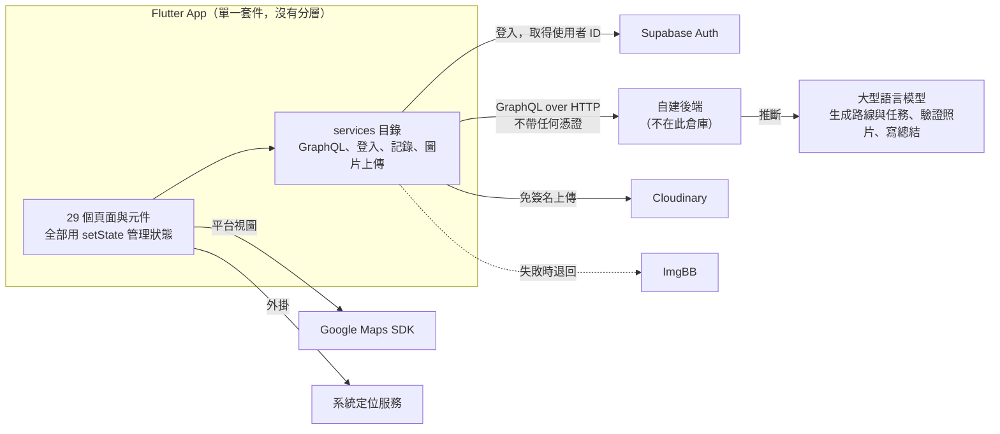
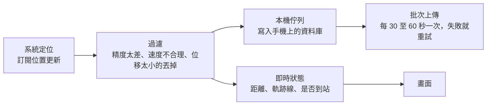

# Mambo 漫步（City Walk）— 技術評審

> 評審基準：commit `bbf67d9`　｜　撰寫與外部事實查證日期：2026-10-08
>
> 前提（已與產品負責人確認）：
> - 目標市場是海外華人與國際旅客；產品主線是 v1「AI 生成路線＋任務打卡」
> - **只評審客戶端**。後端不在這個倉庫，相關內容都是從 App 呼叫的 API 推斷的
> - **開發主要靠 AI 輔助**，沒有固定的技術偏好
>
> 姊妹文檔：`docs/product-ux-marketing-analysis.md`（下稱「產品文檔」）。安全問題的清單在那份的 6.9 節，這裡不重複列，只寫怎麼修。

---

## 1. 結論先行

### 四個裁決

**一、不要換框架。留在 Flutter，在新的分層上把 v1 的核心頁面逐頁重建。**
這次找到的問題沒有一個是 Flutter 造成的，換框架一個也解決不了：API 沒有身份驗證、沒有資料模型、一個檔案 1,980 行、依賴落後五個大版本、總結頁的數字寫死。而這個 App 最吃重的地圖，Flutter 的外掛是由 Google 與 Mapbox 官方發佈的，React Native 那邊主要靠社群維護。重寫要花的時間換不到任何用戶看得見的東西。詳見第 9 節，包括在什麼情況下應該重新考慮。

**二、地圖現在留在 Google Maps，該換的是用法。**
行動端 SDK 的地圖載入在 Google 的定價頁上列為不限量免費，外掛由 Flutter 官方維護，產品現階段需要的能力它都做得到。現在的問題出在用法：每秒重建兩次、預設圖釘、沒有樣式、把互動地圖塞進捲動頁、截圖拿不到地圖。另外要知道一個綁定關係：如果後端用 Google Places 取得地點，Google 的條款要求這些結果必須顯示在 Google 地圖上，所以**地圖和地點資料是一起選的**。當離線地圖成為必要，或品牌化地圖成為賣點時，再評估 Mapbox。詳見第 5 節。

**三、後端建議收斂到 Supabase，把現有後端縮成只負責 AI 的服務。**
App 已經用 Supabase 登入，卻沒有用它的資料庫和儲存。把資料搬進去並啟用資料列層級的存取政策，可以從結構上堵住「任何人都能讀寫別人的軌跡」這個洞，同時砍掉兩個圖片供應商。AI 相關的動作留在伺服器端。不論最後搬不搬，**現有後端都應該先加上驗證登入憑證這一步**。詳見第 8 節，包括什麼情況下不該搬。

**四、最該先還的技術債有五筆：**

| # | 債 | 為什麼排在前面 |
|---|---|---|
| 1 | API 不帶身份憑證，金鑰在版本控制裡 | 上架與宣傳的前提（產品文檔 6.9） |
| 2 | 工具鏈與依賴落後，Android 很可能已經編不過 | 其他所有改動都要先能建置、能驗證 |
| 3 | 沒有資料模型，沒有統一的 API 層 | AI 輔助開發最需要型別來擋錯 |
| 4 | 行走頁是一個 1,980 行、38 個狀態欄位、4 個計時器的元件 | 產品文檔裡最多的 UX 問題都集中在這一頁 |
| 5 | 沒有任何有效的測試，CI 不跑靜態分析 | 沒有自動回饋，每次改動都只能靠人在實機上發現問題 |

### 三個需要立刻確認的新發現

這三項是這次評審才發現的，產品文檔裡沒有。本機沒有 Flutter 工具鏈，無法實際建置，所以都標為推斷，請優先在有環境的機器上驗證。

1. **Android 很可能無法編譯。** 有兩個內容完全相同的 `MainActivity` 檔案，都宣告在同一個套件名下（`android/app/src/main/kotlin/com/example/city_walk/MainActivity.kt` 與 `android/app/src/main/kotlin/com/example/mambo/MainActivity.kt`）。Kotlin 不允許同一個模組裡有兩個同名類別。第二個檔案是 2025-07-08 加入的，而 CI 只建 iOS，所以這個問題可能已經存在一年多沒被發現。
2. **Android 14 以上的背景定位很可能啟動失敗。** 定位外掛鎖在 2023 年的版本，設定檔只宣告了一般的前景服務權限，沒有宣告定位類型專用的那一個。詳見 6.1。
3. **用建立專案時的 Flutter 版本建置，達不到 Google Play 現在要求的目標 API 等級。** Google Play 自 2026-08-31 起要求新 App 與更新以 API 36 為目標；專案的目標等級跟隨 Flutter SDK 的預設值，而專案建立時用的 3.29 比 API 36 的正式發佈還早。詳見第 10 節。

---

## 2. 評審範圍與限制

**讀了什麼**

- `lib/` 下全部 34 個 Dart 檔（約 11,900 行）
- `pubspec.yaml`、`pubspec.lock`（146 個套件的鎖定版本）
- Android 的 Gradle 設定與設定檔、iOS 的 Podfile、Podfile.lock 與專案設定
- CI 設定、43 筆 commit 歷史

**沒有做什麼**

- **沒有執行任何東西。** 這台機器沒有安裝 Flutter 或 Dart，所以沒有跑 `flutter analyze`、`flutter test`、`flutter pub outdated`，也沒有建置。文中凡是「編不過」「會失敗」的說法都是讀程式碼得出的推斷。
- **沒有看後端。** `lib/services/mambo2.code-workspace` 指向同層的 `mambo_backend`，這台機器上沒有。後端用什麼語言、有沒有做驗證、資料怎麼存，都不知道。

**建議在有 Flutter 的機器上補跑這四個命令**，結果可以直接驗證或推翻本文的推斷：

```bash
flutter analyze            # 靜態分析的問題數
flutter pub outdated       # 與本文附錄 A 對照
flutter build apk --debug  # 驗證 Android 能否編譯
flutter test               # 目前唯一的測試預期會失敗
```

**外部事實的來源**

套件版本來自 pub.dev 的 API，Flutter 版本來自官方的發佈清單，定價、限制與政策來自各家的官方頁面，全部在 2026-10-08 查證，來源列在附錄 B。定價和限制會變動，採用前請再看一次原頁面。少數沒有查證、只基於一般認知的說法，文中會標明。

**標記約定**

- 證據寫成 `檔案:行號`。`lib/` 下的檔案只寫檔名，其他檔案寫完整相對路徑。
- 「推斷」表示需要實際建置、實機或後端程式碼才能證實。
- 工作量以一至兩人加 AI 輔助估算：S＝數天、M＝一至兩週、L＝兩週以上。

---

## 3. 現況架構



圖上有五個外部服務。Supabase 只用了登入這一項功能，使用者的 ID 被當成普通參數傳給自建後端。

**實際的分層狀況：**

| 面向 | 現況 | 數字 |
|---|---|---|
| 狀態管理 | 沒有使用任何狀態管理套件 | 19 個有狀態元件、103 處 `setState` |
| 依賴注入 | 沒有。服務在需要的地方直接建立新實例 | `GraphQLService()` 7 處、`AuthService()` 16 處 |
| 資料模型 | v1 完全沒有，直接操作 JSON 解出來的字典 | `Map<String, dynamic>` 出現 98 次 |
| 網路層 | 每個 API 方法各自組請求、各自處理錯誤 | 30 處 `http.post`，只有 3 處設了逾時 |
| 路由 | 命令式導航，沒有路由表 | 66 處 `Navigator` 呼叫 |
| 介面與邏輯 | 寫在同一個檔案 | 6 個頁面檔直接匯入 GraphQL 服務 |
| 測試 | 一個失效的範本測試 | 有效測試 0 個 |

---

## 4. 技術棧逐項評審

鎖定版本來自 `pubspec.lock`，最新版本於 2026-10-08 從 pub.dev 查得。完整的版本對照在附錄 A。

| 層 | 現用 | 評價 | 結論 |
|---|---|---|---|
| 框架 | Flutter。專案建立於 3.29.0（2025-02），現行穩定版是 3.47.6（2026-10），中間隔了六個穩定版 | 選擇沒有問題。落後造成的實際後果見第 10 節 | **保留，升級** |
| 語言 | Dart 3，有健全的空值安全 | 型別系統沒有被用上：資料都是 `dynamic` | 保留，補上模型 |
| 狀態管理 | 無 | 見第 7 節 | **導入一個**，並寫進專案規則 |
| 路由 | 命令式 `Navigator` | 堆疊有實際的錯誤；深連結做不了 | **換成 `go_router`**（Flutter 官方發佈） |
| 網路 | `http` 1.3.0，手寫 GraphQL 字串 | 套件本身沒問題，問題是沒有集中 | 保留套件，**建立單一的 API 層** |
| 登入 | `supabase_flutter` 2.8.4，最新 2.18.0 | 用法正確 | 保留，升級；把它的登入憑證帶給後端 |
| 設定與金鑰 | `flutter_dotenv`，把 `.env` 當資源打進安裝包 | 檔案內容任何人解開安裝包都看得到。見 10.2 | **換成建置時注入**（`--dart-define-from-file`） |
| 地圖 | `google_maps_flutter` 2.10.1，最新 2.18.2 | 選擇合理，用法有問題。見第 5 節 | **保留，升級，改用法** |
| 定位 | `location` 5.0.3（2023-08），最新 10.0.2 | 落後五個大版本，期間有與 Android 14 相關的修正。見第 6 節 | **升級** |
| 拍照與選圖 | `image_picker` 1.1.2 | 官方外掛，沒問題 | 保留，升級 |
| 圖片壓縮 | `flutter_image_compress` 2.4.0 | 套件沒問題；壓縮策略只調品質參數、不縮尺寸，所以畫質很差 | 保留，改策略 |
| 存到相簿 | `image_gallery_saver` 2.0.3 | 最後一次發佈是 2023-07，沒有登記發佈者 | **換成 `gal`**（2.3.3，2026-07） |
| 圖片上傳 | Cloudinary 免簽名上傳，失敗退到 ImgBB | 兩個供應商，其中一個的金鑰放在客戶端 | **替換**，見第 8 節 |
| 本機儲存 | `shared_preferences`；`sqflite` 已宣告但沒有任何引用 | 手賬配額存在本機，重裝即重置 | 配額移到伺服器；`sqflite` 先移除 |
| 分享 | `share_plus` 10.1.4，最新 13.3.1 | 落後三個大版本，目前用的分享方法已被新介面取代 | 升級 |
| 音效 | `audioplayers` 5.2.1（2023-11），最新 6.8.1；三個未壓縮的 WAV 共 1.5 MB | 可用 | 升級；音檔轉成壓縮格式 |
| 截圖 | `screenshot` 3.0.0 | 唯一的擷取呼叫已被註解掉，而且它擷取不到地圖。見 5.2 | **移除** |
| 底部導航 | `convex_bottom_bar` 3.2.0，2023-01 之後沒有更新 | 也是產品文檔 5.3「生成按鈕藏在導航裡」的來源 | **換回內建的導航列** |
| 其他介面套件 | `flutter_staggered_grid_view`（只被無人引用的頁面使用）、`custom_info_window`（完全沒有引用，2021 年後無更新） | 多餘 | 移除 |
| 權限 | `permission_handler`、`app_settings` 只有被匯入，沒有被呼叫 | 目前沒有任何權限引導流程 | 做權限說明流程時真的用上，否則移除 |
| 在地化 | 無。語系寫死為 `zh_CN`（`main.dart:13-14`） | 與雙語定位衝突 | **導入官方的在地化架構** |
| 崩潰回報與分析 | 無 | 產品文檔第 8 節 | 導入 |
| 靜態分析 | `flutter_lints` 5.0.0，沒有任何自訂規則 | 太寬鬆 | 升級並加嚴，見 7.5 |
| Android 建置 | AGP 8.7.0、Kotlin 1.8.22、Gradle 8.10.2 | 是建立專案當時的範本值 | 對齊現行 Flutter 新建專案的範本 |

---

## 5. 地圖模組

### 5.1 現在怎麼用

全 App 有 8 處建立地圖元件，其中 3 處是全螢幕或大面積的互動地圖，5 處是嵌在可捲動頁面裡的小地圖。

| # | 位置 | 用途 | 型態 | 備註 |
|---|---|---|---|---|
| 1 | `walk_preview.dart:381` | v1 預覽選點 | 全螢幕互動 | 標記 |
| 2 | `walk_map_page.dart:894` | v1 行走 | 全螢幕互動 | 標記、圓圈、軌跡線 |
| 3 | `walk_summary.dart:583` | v1 總結 | 嵌在捲動頁，高 300 | 設定了搶佔所有手勢，在地圖上滑動時頁面捲不動（`:636-641`） |
| 4 | `quick_start_map_page.dart:751` | v2 記錄 | 佔畫面上方三分之二 | 軌跡線 |
| 5 | `log_review_page.dart:834` | v2 回顧 | 嵌在捲動頁，外層還有左右滑動的分頁 | 三層手勢互相競爭 |
| 6 | `log_review_result_page.dart:250` | v2 回顧結果 | 嵌在捲動頁 | |
| 7 | `log_entry_detail_page.dart:212` | v2 單筆記錄 | 嵌在捲動頁 | |
| 8 | `walk_history_detail.dart:55` | 無 | — | 整個頁面無人引用 |

沒有用到的能力：地圖樣式、精簡模式、標記聚合、地圖快照、任何路線服務。

### 5.2 用法上的問題

| # | 問題 | 證據 | 影響 | 改法 |
|---|---|---|---|---|
| 1 | 行走頁每秒觸發兩次整頁重建，標記集合每次都重新產生 | `walk_map_page.dart:529-543`、`:719-737`、`:911-957` | 793 行的 `build` 每秒跑兩次，位置更新時再多一次。耗電，也讓這一頁難以維護 | 計時顯示拆成獨立的小元件；標記與折線只在資料變動時重算 |
| 2 | 總結頁的標記顏色是隨機的 | `walk_summary.dart:598` | 每次重建顏色都可能變，也會觸發不必要的原生更新 | 依是否打卡決定 |
| 3 | 預設地圖樣式，預設的紅綠圖釘 | `walk_map_page.dart:921-926` | 和任何一個用 Google 地圖的 App 長得一樣，沒有品牌感，也分不出第幾站 | 套用樣式；自製帶編號的標記 |
| 4 | 自訂標記用已棄用的方法載入，而且把尺寸設成 1×1 | `walk_map_page.dart:208-211`、`walk_summary.dart:51-54` | 顯示大小交給各平台自行決定，不同裝置上可能不一致（推斷） | 改用新的位圖標記介面，明確指定尺寸 |
| 5 | 用地點名稱當標記的識別碼，打卡也用名稱比對 | `walk_preview.dart:399`、`walk_map_page.dart:915`、`:251-258` | 同一條路線有兩個同名地點時會互相覆蓋 | 後端給每個地點穩定的 ID |
| 6 | 沒有自動縮放到涵蓋全部內容；沒有資料時鏡頭落在經緯度 0,0 或紐約中央公園 | `walk_map_page.dart:901-910`、`quick_start_map_page.dart:759`、`log_review_page.dart:253` | 進頁面時常常看不到重點；資料還沒到時會先看到大西洋 | 寫一個共用的「縮放到範圍」；等有資料再顯示地圖 |
| 7 | 5 處把互動地圖嵌在捲動頁裡 | 見 5.1 | 每一處都是一個完整的原生地圖實例；手勢衝突 | 列表與總結改用**靜態圖片**，點了才開全螢幕地圖 |
| 8 | 總結頁原本想用截圖套件存長圖，但擷取不到地圖 | `walk_summary.dart:407-409`、`:471-523` | 地圖是原生視圖，不在 Flutter 自己繪製的畫面裡，截圖會是空白（一般認知）。這段程式後來被註解掉 | 用地圖快照或靜態地圖服務產生圖片，再和其他內容合成 |
| 9 | 備用方案是在客戶端組出靜態地圖的網址，金鑰直接放在網址裡 | `walk_summary.dart:944-960`、`:999` | 靜態地圖的金鑰無法像行動端 SDK 那樣綁定 App，放在客戶端等於公開 | 由後端產生圖片或代簽網址 |
| 10 | Android 已經套用了 Google 的金鑰管理外掛，卻沒有使用，金鑰仍寫死在設定檔 | `android/app/build.gradle.kts:6`、`android/app/src/main/AndroidManifest.xml:21` | 金鑰進了版本控制 | 用該外掛從本機的屬性檔注入 |
| 11 | API 服務層為了用座標型別而匯入地圖套件 | `graphql_service.dart:5` | 換地圖時連 API 層都要改 | 定義自己的座標型別 |
| 12 | 球面距離的計算有 3 份，其中一份回傳公里、兩份回傳公尺 | `walk_preview.dart:70`、`walk_map_page.dart:277`、`quick_start_map_page.dart:156` | 單位混用是典型的錯誤來源 | 只留一份，並寫測試 |
| 13 | iOS 鎖定的地圖 SDK 是 8.4.0；外掛現在最低支援 iOS 15，並把預設的 iOS 實作標為不再更新的舊版 | `ios/Podfile.lock:20`、`ios/Podfile:2` | 升級外掛時 iOS 最低版本要跟著調，並選擇新的實作 | 隨第 10 節的升級一起處理 |

### 5.3 產品真正需要地圖做什麼

把產品文檔第 5 節提出的需求，對應到地圖要具備的能力：

| 產品需求 | 需要的能力 | 現用的外掛做得到嗎 |
|---|---|---|
| 標記有編號，看得出已到與未到 | 自訂標記圖 | 可以 |
| 畫出建議的行走順序 | 折線，加上路線資料 | 折線可以；路線資料要由後端呼叫路線服務取得 |
| 常駐顯示下一站的方向與距離 | 不需要地圖 SDK，在本機算方位角與距離即可 | — |
| 一鍵導航 | 開啟系統的地圖 App | 可以，用來開啟連結的套件已經是間接依賴 |
| 有品牌感的地圖 | 自訂樣式 | 可以，外掛提供 `style` 與 `mapId` 兩種方式 |
| 分享卡與歷史列表的地圖縮圖 | 靜態地圖圖片 | 可以，用靜態地圖服務或地圖快照 |
| 弱網與離線 | 下載離線區域 | **做不到**。SDK 會快取看過的區域，但沒有讓開發者下載指定區域的介面（一般認知，未查證） |
| 全球各地的地點品質 | 地點資料庫，在後端使用 | 可以，但見下方的綁定關係 |

除了離線，現階段的需求 Google 的外掛都做得到。

### 5.4 方案比較

| | Google Maps（現用） | Mapbox | MapLibre 加圖磚供應商 | `flutter_map` | Apple MapKit |
|---|---|---|---|---|---|
| Flutter 外掛 | `google_maps_flutter`，Flutter 官方發佈，2.18.2（2026-09） | `mapbox_maps_flutter`，Mapbox 官方發佈，3.0.0（2026-10），需要 Flutter 3.38.1 以上 | `maplibre_gl`，MapLibre 組織發佈，0.27.1（2026-09），版本號仍在 0.x | `flutter_map`，8.3.2（2026-08） | `apple_maps_flutter`，社群維護，1.4.0（2025-01） |
| 平台 | Android、iOS、Web | Android、iOS | Android、iOS、Web | 所有平台，純 Flutter 繪製 | 只有 iOS |
| 計費方式 | 行動端 SDK 的地圖載入列為不限量免費；地點、路線、靜態圖另外計費 | 按月活躍用戶：25,000 人以內免費，之後每千人 4 美元 | 外掛免費；圖磚要自架或向供應商付費 | 同左 | 免費 |
| 樣式自由度 | 中 | 高 | 高，但樣式要自己準備 | 原生只支援點陣圖磚，樣式取決於供應商 | 低 |
| 離線 | 沒有開發者介面（未查證） | 支援，Android 與 iOS | 支援離線區域，Android 與 iOS | 可搭配快取外掛，但公共的 OpenStreetMap 圖磚明文禁止離線預抓 | 無 |
| 輸出成圖片 | 靜態地圖服務每月 10,000 次免費，之後每千次 2 美元；另有地圖快照 | 支援快照；靜態圖片服務每月 50,000 次免費 | 說明文件沒有提到 | 不是原生視圖，可以直接擷取 | — |
| 步行路線 | 路線服務每月 10,000 次免費，之後每千次 5 美元 | 每月 100,000 次免費，之後每千次 2 美元 | 需另找路線服務 | 同左 | 未查證 |
| 地點資料 | Places；條款要求結果顯示在 Google 地圖上 | 有自家的搜尋服務（未查證） | 需另找 | 需另找 | — |
| 從現況遷移 | 不需要 | 中：7 個使用中的呼叫點、標記與折線重寫、金鑰與建置設定 | 中至高：還要選圖磚供應商、準備樣式 | 中：還要選圖磚供應商 | 高：Android 要另一套 |

兩點補充：

- **`flutter_map` 加上免費的 OpenStreetMap 公共圖磚不是一個可行的上線方案。** OpenStreetMap 基金會的使用政策寫明不允許重度使用、禁止離線預抓，而且可以不經通知就封鎖存取。
- **地圖和地點資料是綁在一起的。** Google 的 Places 政策寫明：「Places API 的結果若顯示在地圖上，必須是 Google 地圖。」所以如果後端用 Places 取得或校驗地點（從回傳欄位裡有地點照片網址來看很可能是，但無法確認），就不能只把客戶端的地圖換成別家。

### 5.5 建議

**現在：留在 Google Maps。** 四個理由：

1. 已經整合，而且行動端的地圖載入不計費。
2. 外掛由 Flutter 官方維護，是所有選項裡維護風險最低的。
3. 除了離線之外，產品現階段需要的能力都做得到（5.3）。
4. 地點資料很可能來自 Google，條款把兩者綁在一起。

**要做的改動，依優先順序：**

| # | 改動 | 工作量 |
|---|---|---|
| 1 | 建立一個共用的地圖元件，全 App 只有它接觸地圖 SDK；同時定義自己的座標型別 | M |
| 2 | 升級外掛到 2.18.x，iOS 最低版本調到 15，改用新的 iOS 實作 | S |
| 3 | 金鑰改由建置時注入，並在 Google Cloud 後台限制只有這個 App 能用 | S |
| 4 | 帶編號的自製標記；進頁面自動縮放到全部內容 | S |
| 5 | 把計時顯示從整頁重建中拆出來 | S，隨第 7 節的行走頁重構一起做 |
| 6 | 總結、歷史、回顧頁的小地圖改用靜態圖片 | M，圖片由後端產生 |
| 7 | 套用品牌化的地圖樣式 | S，設計完成後 |
| 8 | 畫出建議順序；常駐下一站的方向與距離；一鍵開啟系統地圖導航 | M，需要後端提供順序與路線 |

第 1 項最重要。它的介面大致如下，重點是呼叫的頁面只描述「要顯示什麼」，不接觸任何地圖 SDK 的型別：

```dart
// 自己的座標型別。服務層與資料模型都用它，不再依賴地圖套件
class GeoPoint {
  const GeoPoint(this.lat, this.lng);
  final double lat, lng;
}

// 全 App 唯一接觸地圖 SDK 的元件。換地圖供應商時只需要重寫這一個檔案
class WalkMap extends StatelessWidget {
  const WalkMap({
    required this.stops,        // 每一站：ID、編號、座標、是否已到
    this.track = const [],      // 已經走過的軌跡
    this.plannedRoute,          // 建議的行走路線
    this.surprises = const [],  // 驚喜地點
    this.fit = MapFit.allContent,
    this.onStopTap,
  });
  // ...
}
```

**什麼時候重新評估，換成別家：**

- 離線地圖成為必要功能。這是 Google 的 SDK 做不到的。
- 品牌化的地圖成為賣點，而 Google 提供的樣式自由度不夠。
- 後端的地點資料改用 Google 以外的來源，綁定關係解除。
- 用戶規模下，按月活躍用戶計費的成本可以接受。

如果要換，**首選 Mapbox**：外掛由官方發佈，同時有離線、快照和額度較寬的路線服務。MapLibre 的好處是不綁供應商，但圖磚與樣式都要自己組，外掛也還在 0.x。`flutter_map` 原生只支援點陣圖磚，不建議當主地圖。Apple MapKit 只有單一平台，不考慮。

有了上面第 1 項的共用元件，切換的範圍會從「7 個頁面」縮小成「1 個檔案加上建置設定」。

### 5.6 地圖相關的後端成本

地點校驗和路線規劃應該在後端做，但費用需要事先知道。以下數字來自 Google 的定價頁：

| 服務 | 每月免費額度 | 超過後每千次 |
|---|---|---|
| 文字搜尋（Pro） | 5,000 | 32 美元 |
| 附近搜尋（Pro） | 5,000 | 32 美元 |
| 地點詳情（Essentials） | 10,000 | 5 美元 |
| 路線計算（Essentials） | 10,000 | 5 美元 |
| 靜態地圖 | 10,000 | 2 美元 |

**估算**：假設每次生成路線要用文字搜尋校驗 10 個地點，免費額度大約夠每月 500 次生成；超過之後，單是校驗每次生成就要約 0.32 美元。兩個降低成本的方向：

- Google 的政策允許永久保存地點的 ID。可以把校驗過的地點存成自己的地點庫，同一個地點不重複查。
- 產品文檔 6.7 提到的「城市路線庫」同時也是成本手段：走過的好路線直接重用，不必每次重新生成和校驗。

---

## 6. 定位與軌跡

對一個步行 App 來說，軌跡記錄得準不準、鎖屏後會不會斷，是最基本的品質。這一塊目前是最脆弱的。

### 6.1 現況

| 項目 | 現況 | 證據 |
|---|---|---|
| 外掛版本 | `location` 5.0.3，2023-08 發佈；最新是 10.0.2 | `pubspec.lock` |
| 取樣設定 | v1：高精度、每 10 秒、位移 10 公尺。v2：每 2 秒、位移 3 公尺 | `walk_map_page.dart:109-113`、`quick_start_map_page.dart:127-131` |
| 背景模式 | 只有 v1 行走頁開啟。進入頁面時直接呼叫，沒有檢查權限，也沒有處理失敗 | `walk_map_page.dart:104-114` |
| 軌跡怎麼記 | 不是訂閱位置更新，而是用 10 秒計時器去讀「最近一次的位置」 | `walk_map_page.dart:546-563` |
| 怎麼上傳 | 每個點一次請求，另外每 10 秒再傳一次統計。失敗就丟掉，並彈出錯誤 | `walk_map_page.dart:568-583`、`:200-204` |
| 距離怎麼算 | 相鄰兩次取樣的直線距離累加，沒有過濾定位誤差 | `walk_map_page.dart:552-556` |
| v2 的回傳 | 每上傳一個點，伺服器回傳整段軌跡，客戶端整段重畫 | `graphql_service.dart:853-861`、`quick_start_map_page.dart:273-282` |

**由此產生的問題：**

- **Android 14 以上很可能無法在背景記錄（推斷）。** 設定檔只宣告了一般的前景服務權限（`android/app/src/main/AndroidManifest.xml:5`），服務則宣告為定位類型（`:49-52`）。`location` 外掛的更新紀錄寫明，6.0.0 起 Android 的背景使用需要定位類型專用的前景服務權限，9.0.0 特別為了「讓背景定位在 Android 14 以上繼續運作」補上了服務類型的宣告。專案鎖在這些修正之前的版本。
- **一小時的漫步會發出約 720 次請求。** 每 10 秒兩次。在漫遊或訊號差的環境，失敗的點直接遺失，用戶還會一直看到錯誤提示。
- **站著不動時距離會慢慢增加（推斷）。** 定位在原地會漂移，每 10 秒把漂移量加進總距離。
- **v2 的做法流量會隨時間快速成長。** 每次回傳的內容隨點數線性增加，累計起來是平方級。走一小時、每 10 秒一個點，最後幾次回傳各帶 300 多個點。
- **軌跡只存在這一頁的記憶體裡。** App 被系統回收後，已走的軌跡線就不見了，雖然伺服器上有。

### 6.2 建議的設計

把軌跡記錄做成一個**獨立於頁面的元件**，生命週期跟著「這一趟漫步」，而不是跟著某個頁面：



- **訂閱更新，不要用計時器輪詢。** 外掛本來就會依設定的時間與位移間隔推送新位置。
- **先過濾再使用。** 精度超過約 30 公尺的點不計入距離；換算速度明顯不是步行的點丟棄。
- **先寫本機，再批次上傳。** 斷網時繼續記錄，恢復後補傳。App 重啟時從本機還原軌跡。
- **距離只在一個地方算**，用過濾後的點。
- 後端需要一個可以一次接收多個點的介面。

### 6.3 外掛怎麼選

| 選項 | 說明 | 適合的時機 |
|---|---|---|
| 把 `location` 升級到 10.x | 更新紀錄寫明 9.0.0「沒有 Dart 介面的變更」；10.0.0 把經緯度改成不可為空，並新增查詢背景權限的方法。期間補上了 Android 14 的服務類型與 iOS 的隱私清單。由個人發佈者維護，8.0.1（2025-06）到 9.0.0（2026-07）之間約一年沒有發佈 | **現在**。改動最小 |
| 換成 `geolocator` | 由一家公司發佈者維護，14.1.1（2026-09），發佈較頻繁。功能範圍相近 | 如果升級後仍有問題，或在意維護的持續性 |
| `flutter_background_geolocation` | 專門做背景追蹤：用動作感測器判斷是否在移動，靜止時自動關閉定位以省電。**正式版建置在 iOS 與 Android 都需要付費授權**，除錯版免費 | 自己做的版本在各家 Android 手機上不穩定，而軌跡又是產品核心時 |

**建議**：先升級 `location`，並照 6.2 自己做佇列與批次上傳。上線前在幾款主流的 Android 手機上實測鎖屏一小時。如果不穩，再評估付費方案。

### 6.4 可能不需要「永遠允許」

目前 App 申請的是最高等級的定位權限：Android 宣告了背景定位（`android/app/src/main/AndroidManifest.xml:4`），iOS 準備了「永遠允許」的說明文字。這會帶來兩個代價：用戶看到這個請求時拒絕率高，Google Play 對背景定位還有額外的申報與審核。

**這個產品的使用情境其實不需要它。** 用戶是在 App 開著的時候按下「開始」，之後才鎖屏放進口袋。依兩個平台的一般規則，這種「從前景開始、持續到背景」的情況，用「使用 App 期間」的權限加上前景服務（Android）或背景定位模式（iOS）就可以涵蓋，iOS 上會顯示藍色的狀態指示。`location` 10.0.0 的更新紀錄也提到，開啟背景模式時新增了一個「是否要求背景權限」的選項。

這一點是依平台的一般認知，沒有在本次逐條查證。實作前請對照兩個平台的官方文件，並在實機上確認。如果成立，可以移除背景定位的宣告，權限請求和商店審核都會簡單很多。

---

## 7. 客戶端架構

### 7.1 為什麼這對 AI 輔助開發特別要緊

AI 寫程式的品質，很大程度取決於它能不能**自己發現自己寫錯了**。目前這個專案幾乎沒有提供這種回饋：

- **沒有型別。** v1 的資料全是字典，欄位名打錯要到執行時才知道。歷史頁裡就有一行同時試兩種寫法的程式：`walk['id'] ?? walk['Id']`（`walk_history.dart:124`）。
- **沒有測試。** 改完之後沒有東西會變紅。
- **檔案太大。** 行走頁 1,980 行，`build` 方法就佔了 793 行。AI 修改大檔案時容易漏改相關的地方，也容易在不知情的情況下重寫一遍已有的邏輯。專案裡的重複實作很可能就是這樣來的。
- **沒有約定。** 沒有一個地方寫明「狀態怎麼管、API 怎麼呼叫、字串放哪裡」，每次生成的寫法都可能不一樣。

所以這一節的建議，排序的依據不是「哪個最優雅」，而是**哪個最能讓機器替你把關**。

### 7.2 主要的結構問題

**一、頁面包辦一切。** `walk_map_page.dart` 一個狀態類別裡有 38 個狀態欄位（`:31-70`）和 4 個計時器，同時負責顯示地圖、追蹤位置、計算距離、判斷打卡、管理任務倒數、拍照上傳、播放音效、呼叫 API 和顯示對話框。業務規則直接寫成散落的數字：打卡半徑 20 公尺（`:249`）、任務時限 15 分鐘（`:164`、`:314`）。

**二、沒有資料模型。** v2 有定義類別（`log_service.dart:33-89`），但同一份解析邏輯寫了兩遍（`:96-199` 與 `:311-389`）。v1 完全沒有。

**三、網路層各寫各的。** 29 個 API 方法各自組請求。其中 18 個只檢查 HTTP 狀態碼，不檢查回應裡的 `errors` 欄位，而 GraphQL 的執行錯誤依慣例是以 200 回傳的。這 18 個全部是 v1 的方法。只有 3 處設了逾時。例外被層層包裝後直接顯示給用戶。

**四、資源釋放重複，非同步後沒有檢查頁面是否還在。**
- 結束漫步時會先手動釋放地圖控制器和音效播放器（`walk_map_page.dart:72-82`，在 `:1655` 被呼叫），之後頁面真正關閉時又釋放一次（`:1679-1692`）。重複釋放可能拋出例外（推斷）。
- 多處在等待網路回應之後直接更新畫面，沒有先確認頁面還在，例如 `walk_map_page.dart:116-121`。用戶在載入中離開頁面時會出錯。

**五、啟動沒有錯誤處理。** `main` 在顯示任何畫面之前先等設定檔載入和 Supabase 初始化（`main.dart:11-22`）。任何一步失敗，用戶看到的是白屏。

**六、導航沒有路由表。** 產品文檔 5.3 與 5.4 提到的堆疊問題（多餘的返回、用開新頁代替返回）都源於此。沒有路由表也就做不了深連結，而深連結是產品文檔 6.7 成長循環的前提。

**七、重複實作。**

| 邏輯 | 份數 | 位置 |
|---|---|---|
| 球面距離 | 3 | `walk_preview.dart:70`、`walk_map_page.dart:277`、`quick_start_map_page.dart:156` |
| 圖片壓縮 | 2 | `walk_map_page.dart:1818`、`quick_start_map_page.dart:378` |
| 選擇照片來源的選單 | 2 | `walk_map_page.dart:425`、`quick_start_map_page.dart:343` |
| 軌跡點的整理 | 2 | `log_review_page.dart:322`、`log_review_result_page.dart:177` |
| 手繪波浪底線 | 2 | `log_review_page.dart:18`、`curly_underline_headline.dart:6` |

**八、已棄用的介面仍在使用。**

| 介面 | 出現次數 | 替代 |
|---|---|---|
| `WillPopScope` | 2 | `PopScope` |
| `Color.withOpacity` | 21 | `Color.withValues` |
| `BitmapDescriptor.fromAssetImage` | 2 | 新的位圖標記介面 |
| `Share.shareXFiles` | 1 | `share_plus` 新版的分享介面 |

### 7.3 目標結構

```
lib/
  app/              應用程式外殼：路由表、主題、在地化設定
  core/
    api/            單一的 API 客戶端：帶憑證、逾時、重試、把錯誤轉成可顯示的訊息
    geo/            座標型別、距離與方位角。全專案唯一的一份
    map/            WalkMap 元件。唯一接觸地圖 SDK 的地方
    media/          選圖、壓縮、上傳、存相簿
    tracking/       軌跡記錄：訂閱、過濾、本機佇列、批次上傳
  features/
    auth/  setup/  preview/  walk/  summary/  history/  profile/
      data/         呼叫 API，回傳有型別的模型
      domain/       模型與規則，例如打卡半徑、任務狀態
      ui/           頁面與元件。只負責顯示，不直接呼叫 API
  l10n/             各語言的字串檔
```

**狀態管理選哪一個**：建議 Riverpod。它同時解決依賴注入和非同步狀態，也容易做出「跟著這一趟漫步、不跟著頁面」的控制器，這正是行走頁和軌跡記錄需要的。如果偏好介面多年沒有變動、寫法更明確的方案，`flutter_bloc` 的 Cubit 也可以。**選哪一個不如「只選一個」重要。**

### 7.4 漸進式重構的順序

不建議一次重寫。每一步都可以獨立上線，前一步是後一步的安全網。

| 步驟 | 做什麼 | 完成的定義 | 工作量 |
|---|---|---|---|
| 0 | 建立安全網：升級到能建置的狀態；CI 在每次提交時跑靜態分析與測試；加嚴分析規則；寫一份專案規則檔 | CI 是綠的；規則檔寫明分層、狀態管理、API 呼叫與字串的約定 | M |
| 1 | 單一的 API 客戶端，加上有型別的模型 | 用錄下來的真實回應寫解析測試；所有請求都帶憑證、有逾時、檢查錯誤欄位 | M |
| 2 | 把純邏輯抽出來並寫測試：距離、打卡判定、任務進度、時間格式 | 每一項都只剩一份，都有單元測試 | S |
| 3 | 行走頁重建：一個漫步控制器加上軌跡記錄元件，畫面拆成十個左右的小元件 | 行走頁的主檔案在 300 行以內；恢復漫步時狀態完整還原 | L |
| 4 | 路由表與深連結 | 沒有任何頁面直接操作導航堆疊 | M |
| 5 | 把字串抽到在地化檔案 | 程式碼裡沒有寫死的顯示文字 | M |
| 6 | 刪除無人引用的程式碼與依賴 | 產品文檔附錄 C 的清單清空 | S |

第 3 步之所以是「重建」而不是「重構」：在一個 1,980 行、沒有測試的檔案裡逐行搬動，比在新的分層上重寫一遍更容易出錯。第 1、2 步完成後，重建只是把已經測過的零件組起來。

第 5 步很適合交給 AI：工作機械、範圍明確，而且改完可以用「搜尋不到寫死的中文字串」來驗證。

**第 0 步建議加嚴的分析規則**：禁止 `print`、未等待的非同步呼叫要報錯、非同步之後使用畫面上下文要報錯、禁止對 `dynamic` 做方法呼叫。這四條剛好對應這次評審中反覆出現的四類問題。

### 7.5 最小的測試策略

目標不是覆蓋率，而是**每次改動之後都有東西可能變紅**。

- **單元測試**：模型解析、距離與方位角、打卡判定、任務狀態。
- **元件測試**：首頁、預覽、總結，各自接上假的資料來源。這類測試不需要模擬器，在任何機器和 CI 上都能跑，AI 也可以自己執行。
- **畫面比對測試**：分享卡。這是會被用戶發到社群上的東西，版面跑掉的代價最高。
- **一條端到端測試**：在模擬器上接假的後端，跑完「生成、預覽、開始、結束」。

---

## 8. 後端方向

後端不在這個倉庫，以下的問題都是從客戶端的呼叫方式推斷出來的。

### 8.1 從客戶端看得到的契約問題

| 問題 | 證據 | 說明 |
|---|---|---|
| 請求不帶任何身份憑證 | `graphql_service.dart` 全檔 | 產品文檔 6.9。使用者 ID 只是一個參數 |
| 唯讀操作被宣告成變更操作 | `graphql_service.dart:446`、`:1454` | 取得任務照片、取得驚喜地點都用 mutation。無法快取，語意也不對 |
| 命名不一致 | `graphql_service.dart:45` 用 `Id`，`:661` 用 `id` | 兩代介面各用一套 |
| 地點沒有穩定的識別碼 | 選點與打卡都用陣列位置（`graphql_service.dart:510-518`、`:559-568`） | 客戶端因此只能用名稱或位置比對 |
| 軌跡一次只能傳一個點 | `graphql_service.dart:353-375` | 見 6.1 |
| v2 每次回傳整段軌跡 | `graphql_service.dart:853-861` | 見 6.1 |
| 總結故事沒有保存 | `walk_summary.dart:241-256` | 每次打開都重新生成 |
| 生成路線是同步等待 | `home_page.dart:299-304` | 客戶端最長等 2 分鐘 |
| 圖片由客戶端直接上傳到第三方 | `cloudinary_service.dart:10-20`、`:55-74` | 免簽名上傳；備用供應商的金鑰放在客戶端 |
| 手賬配額不在伺服器上 | `scrapbook_quota_service.dart:12-13` | 客戶端的限制不構成限制 |

### 8.2 三條路線

| | A：保留自建後端，補上驗證 | B：收斂到 Supabase，AI 留在伺服器端函式 | C：換到其他後端即服務（例如 Firebase） |
|---|---|---|---|
| 怎麼解決授權問題 | 每個操作都要記得檢查「這筆資料是不是這個用戶的」。漏一個就是漏洞 | 在資料庫層設定存取政策，預設拒絕。漏設的後果是「讀不到」而不是「洩漏」 | 類似 B，用該平台的安全規則 |
| 外部供應商數量 | 五個，不變 | 三個：Supabase、語言模型、Google 地圖 | 三個，但登入要遷移 |
| 資料模型的適配 | 不變 | 漫步、地點、任務、照片是典型的關聯式資料，適合；有地理擴充可用 | 文件型資料庫，關聯查詢較不直接 |
| 對 AI 輔助開發 | 取決於現有後端的品質，無法評估 | 資料表結構、存取政策、函式都是倉庫裡的文字檔，可以審查、可以測試 | 類似 B |
| 長時間的 AI 任務 | 自己掌控 | 受平台限制，見 8.4 | 類似限制 |
| 遷移成本 | 最低 | 中：資料表、存取政策、圖片、客戶端的資料層 | 最高：連登入都要換 |
| 主要風險 | 驗證邏輯寫得不完整 | 存取政策寫錯；對單一供應商的依賴加深 | 做了一次沒有必要的遷移 |

### 8.3 建議：B，分三步走

**第一步，現在就做，不論最後選哪條路。**
客戶端在每個請求帶上 Supabase 的登入憑證；後端驗證憑證，並從憑證裡取得使用者 ID，不再相信請求參數。Supabase 的文件建議使用非對稱金鑰，後端從專案的公開金鑰端點（路徑為 `/auth/v1/.well-known/jwks.json`）取得公鑰就能驗證，不需要每次都呼叫 Supabase。舊式的共用密鑰仍然可用，但文件寫明不建議用於正式環境。

**第二步，圖片搬到 Supabase 的儲存服務。**
每個用戶只能寫入自己的目錄，用存取政策控制。Cloudinary 的免簽名上傳與 ImgBB 可以一起拿掉，少兩個供應商，也少一把放在客戶端的金鑰。

**第三步，資料搬進 Supabase 的資料庫，啟用資料列層級的存取政策。**
一般的讀寫由客戶端透過 Supabase 的套件直接進行，不必再經過自建後端。AI 相關的動作（生成路線、派發任務、驗證照片、寫總結、生成手賬封面）留在伺服器端。

搬的時候順手解決 8.1 的契約問題：每個地點有穩定的 ID；軌跡批次寫入；總結故事和手賬封面生成一次後存起來；配額記在伺服器；v1 的漫步與 v2 的記錄合併成同一種資料（產品文檔 4.6）。

### 8.4 AI 的動作放在哪裡

Supabase 的伺服器端函式有這些限制（官方文件）：

| 項目 | 限制 |
|---|---|
| 總執行時間 | 免費方案 150 秒，付費方案 400 秒 |
| 請求閒置逾時 | 150 秒內沒有送出回應，會收到閘道逾時 |
| 每次請求的 CPU 時間 | 2 秒。等待外部服務回應的時間不算在內（一般認知） |
| 記憶體 | 256 MB |

生成路線目前客戶端最長會等 120 秒，離 150 秒的上限很近。**不論放在哪裡，生成都應該改成非同步**：客戶端送出請求後立刻拿到一個工作編號，之後輪詢或訂閱進度。這同時解決產品文檔 5.3 提到的「等兩分鐘只有轉圈、不能取消」，因為有了進度就能顯示分階段的文案。

**AI 的部分要不要也搬進 Supabase 的函式，取決於現有後端：**

- 如果現有後端在生成、校驗地點上已經有成熟的邏輯，**留著它**，把它縮成一個只負責 AI 的無狀態服務：驗證憑證、呼叫語言模型、把結果寫回同一個資料庫。
- 如果現有後端主要只是把請求轉給語言模型，搬進函式會讓整個系統少一個要部署和監控的東西。

### 8.5 GraphQL 要不要留

目前沒有享受到 GraphQL 的好處：沒有從結構描述產生型別、查詢內容是固定的、請求是手寫字串。

走 B 路線的話，一般讀寫改用 Supabase 的套件，AI 動作改用函式呼叫，GraphQL 這一層會自然消失。走 A 路線的話可以保留，但要補上兩件事：全部改成參數化查詢（v2 的方法已經是），以及從結構描述自動產生 Dart 的型別。

### 8.6 什麼情況下不該搬

- 現有後端已經有大量穩定可用的邏輯，而且有人熟悉它的部署與監控。
- 資料量或地理運算的需求超出一般託管資料庫適合處理的範圍。
- 對單一供應商的依賴有顧慮。

這些情況下，**最小方案是 8.3 的第一步和第二步**：補上驗證，換掉圖片上傳。這兩步就能解決最嚴重的問題。

### 8.7 成本護欄

無論哪條路線，伺服器端都需要：每個用戶每天的生成次數與任務重新整理次數上限、生成結果的保存與重用、每次 AI 呼叫的用量記錄。沒有最後一項，就算不出產品文檔 3.4 和 6.8 所需要的「一次漫步的平均成本」。

---

## 9. 是否轉向其他技術棧

### 9.1 結論

**不轉。** 但理由需要說清楚：不是因為 Flutter 明顯比其他選擇好，而是因為**換的理由不夠**。這個 App 還沒有上架、沒有用戶要遷移，如果今天從零開始，React Native 加 Expo 也是合理的選擇。但已經有一個走得通的 Flutter App，換框架要花掉的時間，換不到任何一項產品文檔列出的改進。

### 9.2 用什麼標準比

既然開發主要靠 AI 輔助，「團隊熟悉哪個語言」不再是決定因素。取而代之的是：

1. **機器能不能驗證改動。** 型別系統夠不夠嚴、靜態分析夠不夠快、測試能不能不靠實機就跑。
2. **生態的成熟度與範例量。** AI 對主流、文件完整的技術表現比較好。
3. **關鍵的原生能力由誰維護。** 對這個 App 就是地圖和背景定位。
4. **整個系統有幾種語言、幾個供應商。**
5. **現有的東西能留下多少。**

### 9.3 比較

React Native 一欄的版本與狀態於 2026-10-08 從 npm 與官方文件查得。

| 標準 | 留在 Flutter | React Native（Expo）加 TypeScript | 原生雙端（Swift 與 Kotlin） |
|---|---|---|---|
| 現有資產 | 全部保留：12,000 行程式、原生設定、走得通的流程 | 全部重寫 | 全部重寫，而且寫兩遍 |
| 機器可驗證性 | 強。Dart 的型別系統是健全的；靜態分析與元件測試都不需要模擬器 | 強。型別檢查與測試同樣不需要模擬器；嚴格程度取決於設定 | 中。各自的工具都好，但建置慢，iOS 一定要 macOS |
| 生態與範例量 | 大 | 最大 | 大，但分成兩個世界 |
| 地圖 | Google 與 Mapbox 的外掛都由官方發佈 | `react-native-maps` 1.29.11，說明寫著「由一小群人維護」；Expo 自家的 `expo-maps` 文件標示為 alpha，會頻繁有破壞性變更 | 直接用官方 SDK，能力最完整 |
| 背景定位 | 靠外掛；最完整的方案是付費的 | 靠外掛；同一家廠商的付費方案也有 React Native 版。Expo 內建的背景定位需要開發版建置，而且用戶關掉 App 後會停止 | 直接用系統介面，掌控度最高 |
| 語言數量 | App 用 Dart，後端與網頁另外算 | 如果後端和分享網頁都用 TypeScript，可以全系統一種語言、共用型別 | 兩種原生語言，加上後端 |
| 不經商店審核更新 | 沒有官方方案，有第三方服務 | Expo 提供（一般認知，本次未查證細節） | 無 |
| 主要風險 | 外掛更新跟不上系統版本。這次的定位外掛就是例子 | 生態變動快：框架目前是 0.87，Expo 已到第 57 版，下一版在測試中 | 兩倍的工作量 |

### 9.4 為什麼不是 React Native

**最有力的支持理由是「一種語言貫穿全系統」。** 如果後端走第 8 節的 B 路線，伺服器端函式是 TypeScript；產品文檔 6.7 的分享網頁也會是 TypeScript。App 也用 TypeScript 的話，資料型別可以共用，一處改動處處報錯。

但這個好處可以用別的方式拿到大半：從資料庫或 API 的結構描述**自動產生** Dart 的型別，一樣是一個來源、改了就會報錯。而換過去要付的代價是具體的：

- 地圖這個核心模組的維護狀況比現在差。
- 背景定位沒有變得更容易。
- 12,000 行重寫，原生設定重做。
- 產品文檔列出的 P0 和 P1，在重寫期間一項都不會前進。

### 9.5 為什麼不是原生

原生在地圖和背景定位上的掌控度最高，這兩項也確實是這個 App 最吃重的地方。但代價是每個功能做兩遍、維護兩套程式碼，對一至兩人的團隊來說不成立。如果只做 iOS，等於放棄半個市場。

折衷的做法是：**主體留在 Flutter，真的遇到外掛做不到的事情時，只把那一小塊用原生寫，包成自己的外掛。** 6.2 的軌跡記錄元件就是最可能走到這一步的地方。

### 9.6 什麼時候該重新考慮

- 後端與網頁都確定用 TypeScript，而且網頁從「一個分享頁」變成一個主要的產品。
- 需要頻繁地不經商店審核就修正線上問題。
- 團隊加入了有深厚 React Native 或原生經驗的工程師。
- 地圖或定位的需求超出外掛的能力，而且不是包一小塊原生程式碼能解決的。

### 9.7 留在 Flutter 要接受的事

- **分享網頁要另外做。** 不建議用 Flutter 的 Web 輸出來做這種需要被搜尋引擎找到、需要快速打開的頁面（一般認知）。用一個小型的網站專案單獨做。
- **要跟上升級。** Flutter 大約每季一個穩定版，專案已經落後六個。落後不只是版本號的問題，見第 10 節。
- **清掉用不到的平台。** 倉庫裡有桌面三個平台和 Web 的資料夾共 69 個檔案，是建立專案時自動產生的。不打算發行就刪掉，減少升級時要處理的東西。

---

## 10. 建置、發佈與工程實踐

### 10.1 問題清單

| # | 問題 | 證據 | 建議 |
|---|---|---|---|
| 1 | 兩個相同的 `MainActivity` 檔案，Android 很可能編不過（推斷） | 見第 1 節 | 刪掉 `city_walk` 目錄下的那一份 |
| 2 | iOS 與 Android 的套件 ID 不同，而且都是範例值 | `ios/Runner.xcodeproj/project.pbxproj:500` 是 `com.example.cityWalk`；`android/app/build.gradle.kts:25` 是 `com.example.mambo` | 定一個正式的 ID，兩邊一致。上架後不能改 |
| 3 | Android 的目標 API 等級跟隨 Flutter SDK 的預設值 | `android/app/build.gradle.kts:29` | Google Play 自 2026-08-31 起要求以 API 36 為目標，可申請延到 2026-11-01。升級 Flutter 是最直接的解法 |
| 4 | Kotlin 1.8.22、AGP 8.7.0、Gradle 8.10.2 | `android/settings.gradle.kts:21-22`、`android/gradle/wrapper/gradle-wrapper.properties:5` | 用現行的 Flutter 新建一個空專案，把這幾個版本對齊過去 |
| 5 | iOS 最低版本有兩個不同的值，而地圖外掛現在要求 15 | `ios/Runner.xcodeproj/project.pbxproj:475` 是 13.0；`ios/Podfile:2` 是 14.0 | 統一調到 15 以上 |
| 6 | 文件寫的 Flutter 版本裝不起來 | `README.md:44` 寫 3.29 以上；`pubspec.lock:1161` 要求 Dart 3.8.0 以上，而 3.29 內含的是 3.7.0 | 實際需要的是 3.32 以上。在倉庫裡用版本檔鎖定確切版本 |
| 7 | CI 不鎖 Flutter 版本 | `.github/workflows/dart.yml:13-15` | 同一份程式碼在不同日子可能建出不同結果。讀取上一項的版本檔 |
| 8 | CI 只能手動觸發，只建 iOS，不跑分析與測試，產物每次覆蓋同一個發佈標籤 | `.github/workflows/dart.yml:4`、`:23`、`:40-41` | 每次提交自動跑分析、測試、Android 與 iOS 建置 |
| 9 | 正式版用除錯金鑰簽名 | `android/app/build.gradle.kts:38` | 產品文檔 6.6 |
| 10 | 建置產物在版本控制裡 | `ios/build/` 下 5 個檔案 | 移除並加入忽略清單 |
| 11 | 用註解來切換後端環境 | `.env` 裡有三行被註解掉的端點 | 開發、測試、正式各一份設定檔，建置時選擇 |
| 12 | 19 處除錯輸出；GraphQL 的完整請求與回應都會被記錄 | `graphql_service.dart:7` | 換成有等級的記錄工具，正式版關閉 |

### 10.2 哪些值可以放在客戶端

「把所有設定都藏起來」做不到，也不必要。安裝包可以被解開，所以原則是：**放進客戶端的值，必須是「被別人拿到也沒關係」的值。**

| 值 | 能不能放 | 怎麼做才安全 |
|---|---|---|
| Supabase 的網址與公開金鑰 | 可以，設計上就是公開的 | 安全性完全靠資料庫的存取政策。所以第 8 節的政策一定要有 |
| Google 地圖的行動端金鑰 | 必須放 | 在 Google Cloud 後台限制只有這個 App 的簽名與套件 ID 可以用 |
| 後端的網址 | 可以 | 後端自己要驗證每個請求 |
| Cloudinary 的免簽名上傳設定 | **不該放** | 它等於一個公開的寫入權限。改成由後端簽名，或換成第 8 節的方案 |
| ImgBB 的金鑰 | **不能放** | 拿掉這個備援 |
| 靜態地圖用的金鑰 | **不該放** | 無法綁定 App。由後端產生圖片 |
| 語言模型的金鑰 | 目前不在客戶端，維持 | — |

做法上，用建置時注入取代把 `.env` 打包進安裝包。這不會讓值變成秘密，但能讓它們離開版本控制，並且讓不同環境用不同的值。

### 10.3 可觀測性

目前線上發生任何問題都無從得知。最少需要兩樣：

- **崩潰回報**：`sentry_flutter` 或 `firebase_crashlytics`，兩者都在持續更新。
- **產品分析**：產品文檔第 8 節的事件清單。

API 層集中之後（7.4 的第 1 步），每個請求的耗時與失敗率可以在一個地方統一記錄。

---

## 11. 技術路線圖

與產品文檔第 7 節的路線圖對齊。標了「產品」的項目是那份文檔已經列出的，這裡只補技術上的做法。

### 兩週內：止血，並讓改動可以被驗證

| 項目 | 對應章節 | 工作量 |
|---|---|---|
| 升級 Flutter 與依賴到現行版本；刪掉重複的 `MainActivity`；對齊 Android 與 iOS 的建置設定；鎖定版本 | 第 4、10 節 | M |
| CI：每次提交跑分析、測試、兩個平台的建置 | 7.4、10.1 | S |
| 客戶端帶上登入憑證；後端驗證 | 8.3 第一步 | M，需後端 |
| 金鑰輪替、限制、移出版本控制；改成建置時注入 | 10.2；產品 6.9 | S |
| 補上 Android 的前景服務權限，實機測試鎖屏記錄 | 6.1 | S |
| 崩潰回報 | 10.3 | S |
| 寫專案規則檔 | 7.4 第 0 步 | S |

### 一到兩個月：打地基

| 項目 | 對應章節 | 工作量 |
|---|---|---|
| 單一的 API 客戶端與有型別的模型；純邏輯抽出並測試 | 7.4 第 1、2 步 | M |
| 共用的地圖元件；編號標記；自動縮放 | 5.5 | M |
| 軌跡記錄元件：訂閱、過濾、本機佇列、批次上傳 | 6.2 | M |
| 行走頁重建 | 7.4 第 3 步；產品 5.5 | L |
| 生成路線改為非同步，有進度 | 8.4；產品 5.3 | M，需後端 |
| 路由表與深連結 | 7.4 第 4 步 | M |
| 在地化 | 7.4 第 5 步；產品 5.8 | M |
| 圖片上傳搬到 Supabase 儲存 | 8.3 第二步 | S 至 M |
| 總結與歷史的地圖改成靜態圖片 | 5.5 | M |

### 之後

| 項目 | 對應章節 | 工作量 |
|---|---|---|
| 資料搬進 Supabase 並啟用存取政策；合併漫步與記錄 | 8.3 第三步 | L |
| 伺服器端配額與成本記錄 | 8.7 | M |
| 自己的地點庫，降低校驗成本 | 5.6 | M |
| 分享網頁，獨立的小型網站專案 | 9.7；產品 6.7 | L |
| 弱網與離線 | 6.2；產品 4.5 | M |
| 依 5.5 的觸發條件評估 Mapbox | 5.5 | — |

---

## 12. 附錄

### A. 依賴版本對照

鎖定版本來自 `pubspec.lock`，最新版本與發佈月份於 2026-10-08 從 pub.dev 的 API 取得。

| 套件 | 鎖定版本（發佈月份） | 最新版本（發佈月份） | 落差 | 使用狀況與建議 |
|---|---|---|---|---|
| `app_settings` | 6.1.1（2025-04） | 9.0.0（2026-08） | 3 個大版本 | 只有被匯入。用不到就移除 |
| `audioplayers` | 5.2.1（2023-11） | 6.8.1（2026-06） | 1 個大版本 | 使用中。升級 |
| `convex_bottom_bar` | 3.2.0（2023-01） | 3.2.0（2023-01） | 已是最新 | 2023 年後無更新。換成內建導航列 |
| `cupertino_icons` | 1.0.8（2024-04） | 2.0.0（2026-09） | 1 個大版本 | 沒有引用。移除 |
| `custom_info_window` | 1.0.1（2021-04） | 1.0.1（2021-04） | 已是最新 | 沒有引用，2021 年後無更新。移除 |
| `flutter_dotenv` | 5.2.1（2024-10） | 6.0.1（2026-04） | 1 個大版本 | 使用中。換成建置時注入 |
| `flutter_image_compress` | 2.4.0（2025-01） | 2.5.1（2026-07） | 1 個次版本 | 使用中。保留 |
| `flutter_lints` | 5.0.0（2024-09） | 6.0.0（2025-05） | 1 個大版本 | 升級並加嚴 |
| `flutter_staggered_grid_view` | 0.6.2（2022-07） | 0.7.0（2023-07） | 1 個次版本 | 只被無人引用的頁面使用。移除 |
| `google_maps_flutter` | 2.10.1（2025-02） | 2.18.2（2026-09） | 8 個次版本 | 使用中。升級 |
| `http` | 1.3.0（2025-01） | 1.6.0（2025-11） | 3 個次版本 | 使用中。保留 |
| `image_gallery_saver` | 2.0.3（2023-07） | 2.0.3（2023-07） | 已是最新 | 2023 年後無更新。換成 `gal` |
| `image_picker` | 1.1.2（2024-05） | 1.2.4（2026-10） | 1 個次版本 | 使用中。保留 |
| `intl` | 0.20.2（2025-01） | 0.20.3（2026-06） | 修訂版 | 使用中。保留 |
| `location` | 5.0.3（2023-08） | 10.0.2（2026-07） | 5 個大版本 | 使用中。**優先升級** |
| `path` | 1.9.1（2024-10） | 1.9.1（2024-10） | 已是最新 | 沒有引用。移除 |
| `path_provider` | 2.1.5（2024-10） | 2.1.6（2026-06） | 修訂版 | 使用中。保留 |
| `permission_handler` | 12.0.0+1（2025-04） | 13.0.2（2026-09） | 1 個大版本 | 只有被匯入。做權限引導時用上 |
| `screenshot` | 3.0.0（2024-05） | 3.0.0（2024-05） | 已是最新 | 擷取功能已被註解掉。移除 |
| `share_plus` | 10.1.4（2025-01） | 13.3.1（2026-10） | 3 個大版本 | 使用中。升級 |
| `shared_preferences` | 2.5.2（2025-02） | 2.5.6（2026-10） | 修訂版 | 使用中。保留 |
| `sqflite` | 2.4.2（2025-02） | 2.4.4+1（2026-10） | 修訂版 | 沒有引用。先移除 |
| `supabase_flutter` | 2.8.4（2025-02） | 2.18.0（2026-09） | 10 個次版本 | 使用中。升級 |

文中提到的候選套件，同一天查得的最新版本：`gal` 2.3.3、`geolocator` 14.1.1、`go_router` 18.0.2、`flutter_riverpod` 3.4.3、`flutter_bloc` 9.1.1、`mapbox_maps_flutter` 3.0.0、`maplibre_gl` 0.27.1、`flutter_map` 8.3.2、`flutter_background_geolocation` 5.8.1、`sentry_flutter` 9.30.1、`firebase_crashlytics` 5.4.0。其中 `go_router` 18 需要 Flutter 3.44 以上，`mapbox_maps_flutter` 3 需要 3.38.1 以上，這是先升級 Flutter 的另一個理由。

### B. 外部事實的來源

全部於 2026-10-08 查證。

| 事實 | 來源 |
|---|---|
| 各套件的版本、發佈日期、發佈者 | pub.dev 的套件 API |
| Flutter 現行穩定版 3.47.6；3.29.0 發佈於 2025-02 並內含 Dart 3.7.0；3.32.0 內含 Dart 3.8.0 | Flutter 官方的發佈清單 |
| `google_maps_flutter` 最低支援 Android SDK 24 與 iOS 15；預設的 iOS 實作為舊版；提供 `style`、`mapId`、僅限 Android 的精簡模式、標記聚合 | pub.dev 上的套件說明與介面文件 |
| `location` 各版本的變更內容 | pub.dev 上的更新紀錄 |
| `flutter_background_geolocation` 的授權條件 | pub.dev 上的套件說明 |
| `mapbox_maps_flutter` 與 `maplibre_gl` 的平台、離線與快照支援 | pub.dev 上的套件說明 |
| `flutter_map` 為純 Flutter 實作、原生只支援點陣圖磚 | flutter_map 官方文件 |
| Google Maps Platform 各項服務的免費額度與單價；行動端 SDK 列為不限量 | Google Maps Platform 定價頁 |
| Places 的結果必須顯示在 Google 地圖上；地點 ID 可永久保存 | Google Places API 政策頁 |
| Mapbox 行動端 SDK、路線服務、靜態圖片的計費 | Mapbox 定價頁 |
| OpenStreetMap 公共圖磚的使用限制 | OpenStreetMap 基金會的圖磚使用政策 |
| Supabase 伺服器端函式的執行限制 | Supabase 官方文件的限制頁 |
| Supabase 登入憑證的驗證方式與公開金鑰端點 | Supabase 官方文件的簽名金鑰頁 |
| Google Play 的目標 API 等級要求與期限 | Android 開發者網站的目標 API 等級要求頁 |
| React Native 0.87.1、Expo 57、`react-native-maps` 1.29.11 | npm 的套件資料 |
| `expo-maps` 為 alpha；Expo 背景定位的條件與限制 | Expo 官方文件 |
| `react-native-maps` 的維護說明 | 該專案的說明文件 |

**沒有查證、基於一般認知的說法**（文中都有標明）：截圖套件擷取不到原生視圖；Google 的 SDK 沒有離線區域的開發者介面；Mapbox 有自家的地點搜尋；從前景開始的定位不需要最高等級的權限；Flutter 的 Web 輸出不適合需要被搜尋引擎找到的頁面；Expo 的免審核更新。

### C. 需要團隊回答的問題

1. 後端用什麼語言和框架？有沒有任何身份驗證或用量限制？
2. 地點資料是不是來自 Google Places？這決定地圖能不能獨立更換。
3. 後端在生成與校驗地點上，有多少現成的邏輯值得保留？這決定第 8 節走到哪一步。
4. 最近一次成功建置 Android 是什麼時候？用的是哪個 Flutter 版本？
5. 是否打算發行 Web 或桌面版？不打算的話可以刪掉對應的資料夾。
6. 生成一條路線，後端目前實際要花多久？呼叫幾次語言模型和地點服務？
